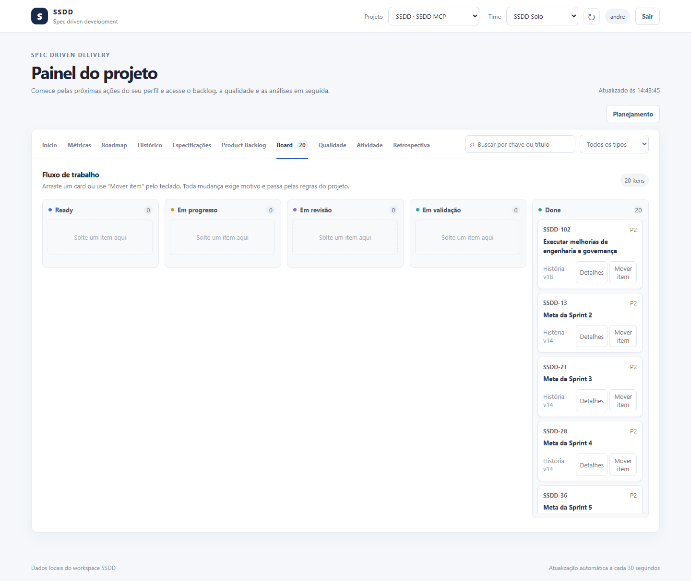

# SSDD MCP

> **Versão `0.3.0-beta.1` (beta-01).** Pronta para avaliação e uso por equipes pequenas. Contratos MCP e esquema do banco podem mudar entre betas; leia as [limitações conhecidas](#limitações-conhecidas-do-beta-01) antes de adotar.

Servidor [Model Context Protocol](https://modelcontextprotocol.io) para **desenvolvimento guiado por especificações**: backlog, sprints e rastreabilidade entre regras de negócio, código e testes, pensado para equipes que trabalham com agentes de IA no editor, no terminal ou em automações.

Um agente de Product Owner registra uma história com critérios de aceite. Um agente de Dev consulta as regras e decisões técnicas vigentes antes de implementar uma tarefa. Um agente de QA registra execuções de cenários publicados, e **uma pessoa certifica**. O time acompanha tudo em um dashboard local, com auditoria de cada mudança.



## O que você ganha

- **Backlog com hierarquia** Épico → Feature → História/Bug → Tarefa, revisões versionadas e critérios de aceite estruturados.
- **Especificações versionadas** (regras, glossários, contratos, ADRs) ligadas a itens por vínculos rastreáveis.
- **QA rastreável:** cenários com revisões publicadas, execuções por build, evidência e **certificação humana** como gate de Done.
- **Gates configuráveis** por projeto (`lite`, `standard`, `strict`) e **aprovações humanas de uso único** para ações de agentes.
- **Planejamento:** times, capacidade, Definition of Done, marcos, sprints, retrospectivas, velocidade e previsão Monte Carlo (P25/P50/P75).
- **Dashboard local** em dez abas, com formulários guiados e acesso por papel ([manual do usuário](docs/manual-usuario.md)).
- **Skills e agentes nativos** para Claude Code, Codex e OpenCode, instalados por um comando.
- **Auditoria, backup/restore e exportação** do workspace sem credenciais.

## Requisitos

Node.js 24 ou 26 e npm 10+. Desenvolvido e validado manualmente no Windows; a CI executa Linux, macOS e Windows.

## Começo rápido

```sh
git clone https://github.com/Decolinow/ssdd-mcp.git
cd ssdd-mcp
npm ci
npm run check          # lint, tipos e testes
npm run build
node dist/src/cli.js init --workspace . --key PAY --name "Pagamentos" --goal "Pagamentos confiáveis" --timezone America/Sao_Paulo
```

`init` cria o banco SQLite em `.ssdd/`, aplica as migrações, registra o projeto e a identidade local. Na primeira execução do servidor, o usuário do sistema vira **administrador** e a `authKey` aparece **uma única vez** em stderr: guarde-a.

### Dashboard

```sh
node dist/src/cli.js dashboard --workspace . --port 4318
```

Abra a URL de uso único impressa no terminal (ou entre com a sua `authKey`). O dashboard escuta apenas em loopback. Guia completo: [manual do usuário](docs/manual-usuario.md).

### Servidor MCP

```sh
npm start                                              # stdio, no diretório atual
node dist/src/cli.js serve --workspace . --port 4319   # Streamable HTTP em http://127.0.0.1:4319/mcp
```

Clientes MCP normalmente iniciam o processo stdio por configuração. Para equipes, mantenha o `serve` em loopback atrás de proxy TLS com OIDC ([runbook de equipe](docs/team-server.md)).

### Agentes e skills em outro repositório

```sh
npm run agents:install -- --target ../meu-projeto            # mostra o plano
npm run agents:install -- --target ../meu-projeto --apply    # instala
npm run agents:install -- --target ../meu-projeto --check    # valida
```

Instala o runtime local em `.ssdd/agent-runtime` e as skills/agentes para Claude Code, Codex e OpenCode, preservando configurações existentes ([guia do instalador](docs/agent-installer.md)).

### Container

```sh
docker compose build
docker compose run --rm ssdd-mcp init --workspace /data --key PAY --name "Pagamentos" --goal "Pagamentos confiáveis" --timezone America/Sao_Paulo
docker compose run --rm -i ssdd-mcp     # MCP por stdio; o volume ssdd-data mantém o banco
```

## Comandos da CLI

| Comando | Função |
|---|---|
| `init` | Cria o workspace e o projeto |
| `stdio` / `serve` | Servidor MCP por stdio ou Streamable HTTP (loopback) |
| `dashboard` | Dashboard e API local |
| `access grant` / `access revoke` | Papéis por projeto para identidades OIDC |
| `doctor` | Diagnóstico read-only do banco |
| `backup` / `restore` | Backup online com manifesto e restauração validada |
| `export` | Exporta JSON, Markdown ou Gherkin, sem credenciais |

Cada subcomando aceita `--help`. Detalhes operacionais no [manual do administrador](docs/manual-administrador.md).

## Segurança em resumo

Dashboard e MCP HTTP só escutam em loopback; sessão web efêmera com verificação de origem e CSRF; RBAC por projeto aplicado nos serviços; auditoria imutável; mutações de agentes exigem aprovação humana de uso único; webhooks com assinatura HMAC; importações externas somente leitura. Para reportar uma vulnerabilidade veja [SECURITY.md](SECURITY.md).

## Limitações conhecidas do beta-01

- **Nó único:** SQLite local, sem alta disponibilidade nem telemetria completa.
- **Certificação de QA** é humana por desenho; os registros deste repositório foram feitos por delegação, em builds locais.
- **Origem `ci`** (execuções confiáveis vindas do pipeline) só foi exercitada com eventos de teste, não com webhook real do GitHub. Importação de resultados apenas em **JUnit** (não Cucumber) e sem tela no dashboard.
- **Sem revisão independente humana** de segurança e dos ADRs 0029 e 0030.
- **macOS** roda na CI mas não teve validação manual.
- **Dashboard:** seleção de time/sprint/marco em formulários ainda é por chave ou UUID digitados; revisão de acessibilidade feita sem leitor de tela.
- O pacote é **privado** (não publicado no npm); instale a partir do repositório ou de `npm pack`.

## Documentação

| Documento | Conteúdo |
|---|---|
| [Manual do usuário](docs/manual-usuario.md) | Tela por tela do dashboard, com imagens e fluxos por papel |
| [Manual do administrador](docs/manual-administrador.md) | Instalação, identidades, backup/restore, atualização e solução de problemas |
| [Dashboard e projeções](docs/dashboard.md) | Abas, rotas, filtros, projeções e regras de interface |
| [Contrato MCP](docs/mcp.md) | Ferramentas, filtros, formatos e erros; veja também a [matriz de paridade MCP](docs/mcp-parity-matrix.md) e a [do dashboard](docs/dashboard-parity-matrix.md) |
| [Especificação funcional](docs/specification.md) | Domínio, papéis, fluxos e critérios de aceite |
| [Arquitetura](docs/architecture.md) | Módulos, persistência, auditoria, concorrência e segurança |
| [Servidor de equipe](docs/team-server.md) | OIDC, proxy TLS, probes e limites do SQLite |
| [Instalador de agentes](docs/agent-installer.md) | Runtime local, skills e agentes para Claude Code, Codex e OpenCode |
| [Demo local](docs/demo.md) | Trilha PO → Dev → QA com cliente stdio |
| [Desenvolvimento](docs/development.md) | Ambiente, testes, migrações, empacotamento e contribuição |
| [Benchmark de busca semântica](docs/semantic-search-benchmark.md) | Metodologia e resultados |
| [ADRs](docs/adr/) | 30 decisões de arquitetura (stack, transportes, OIDC, aprovações, webhooks, importações, métricas, gates, CI) |
| [CHANGELOG](CHANGELOG.md) | Notas de versão |
| [CONTRIBUTING](CONTRIBUTING.md) | Como contribuir |

## Licença

[Apache License 2.0](LICENSE).
