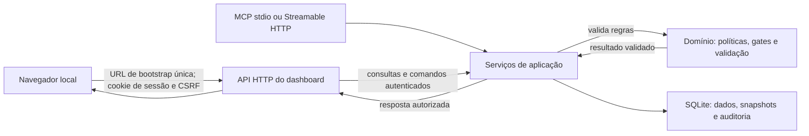

# Arquitetura e operação

## Componentes

Monólito modular em Node.js 24 ou 26 e TypeScript estrito. O runtime recomendado é Node 26; a CI mantém cobertura de Node 24. O servidor usa `@modelcontextprotocol/server` 2.4.0 e a especificação MCP `2026-07-28`. O armazenamento usa SQLite via `better-sqlite3` 12.11.1. A abertura verifica foreign keys, WAL em arquivo, FTS5 e funções JSON. A compatibilidade multiplataforma ainda depende da execução da matriz CI. A API do dashboard e a ponte Streamable HTTP usam `node:http` e chamam os mesmos serviços da aplicação que o MCP; o servidor entrega os assets estáticos do dashboard e o build os copia para `dist`. FTS5 cobre pesquisa textual com filtro por projeto aplicado antes de retornar resultados. As decisões estão registradas em [ADR 0001](adr/0001-stack-inicial.md), [ADR 0002](adr/0002-streamable-http-local.md), [ADR 0007](adr/0007-receptor-de-webhooks.md), [ADR 0008](adr/0008-referencias-github.md), [ADR 0011](adr/0011-times-multiplos-por-projeto.md), [ADR 0018](adr/0018-retrato-historico-do-projeto.md), [ADR 0019](adr/0019-autenticacao-perfis-e-busca-semantica.md), [ADR 0020](adr/0020-perfis-contexto-e-busca-eficiente.md), [ADR 0023](adr/0023-workflow-ponderado-por-tarefa.md), [ADR 0024](adr/0024-prioridade-valor-e-roadmap-por-feature.md), [ADR 0025](adr/0025-dashboard-home-por-papel.md) e a proposta sobre erros de tools [ADR 0026](adr/0026-contrato-de-erros-das-tools.md). A fotografia técnica deste workspace também está registrada no MCP como `SSDD-ARCH-2026-01`, revisão 1 publicada após revisão de Tech Lead; consulte com `spec_get`. Ela descreve o estado observado, e sua publicação não é um gate de release.

| Módulo | Responsabilidade |
|---|---|
| `domain` | Backlog, especificações, qualidade, time, sprints e políticas |
| `application` | Comandos, consultas, transações, autorização e contratos internos |
| `application/task-context` | Montagem de recortes por tarefa, resolução de revisões de baseline, fontes, orçamento e cursor estável |
| `application/work-item-workflow` | Transições auditadas, gates Ready/Done, evidências imutáveis e certificação QA |
| `application/task-development-start` | Readiness report read-only e início transacional de tarefa + sessão, com revalidação e request ID idempotente |
| `application/task-workflow-commands` / `application/task-workflow-queries` | Revisões imutáveis de etapas ponderadas, publicação com carry/reset sequencial, histórico de status, pinagem na sessão e cálculo de progresso pela soma dos pesos Done |
| `application/adr-commands` / `application/specification-queries` | Criação/relação de ADR e pesquisa textual paginada de revisões de especificação |
| `application/team-capacity` | Configuração versionada de time, calendário, disponibilidade e cálculo de capacidade |
| `application/milestones` | Aprovação de marcos, pinning de PBIs e histórico imutável de escopo |
| `application/definition-of-done` | Revisões imutáveis dos critérios compartilhados de conclusão do projeto |
| `application/sprint-commands` / `application/sprint-queries` | Planejamento, validação, transições, escopo e snapshots de sprint |
| `application/metrics-queries` | Redução read-only de eventos, snapshots de sprint/marco, composição de PBIs por corte, WIP e cobertura |
| `application/dashboard-metrics` | Agrega métricas autorizadas e previsão em um snapshot comum consumido pela API local e por `metrics_get` |
| `application/forecast-queries` | Simulação Monte Carlo, capacidade futura, bloqueios, probabilidade até a meta e histórico recalculável |
| `application/development-lifecycle` | Sessões de desenvolvimento versionadas, métricas de esforço individual, eventos imutáveis de deployment e gates de build entre homologação e produção |
| `application/roadmap-identifiers` | Vínculos imutáveis, por projeto, entre ID estável `SSDD-###` e work item gerado |
| `application/prioritized-roadmap` | Fila de tarefas com os mesmos gates de início e ordenação por prioridade/valor; progresso e previsão de Features com amostra histórica suficiente |
| `application/dashboard-quick-access` / `application/task-development-claim` | Home autenticada por papéis concedidos, filas resumidas e claim idempotente de Ready sem responsável após revalidar gates |
| `application/user-management` | Bootstrap do administrador único, identidade por authKey, memberships por projeto, rotação/revogação e auditoria administrativa global |
| `application/semantic-work-item-search` | Indexação vetorial paginada, cache por projeto/modelo/conteúdo, busca por similaridade e filtro pelo principal atual |
| `integrations/embeddings` | Cliente OpenAI-compatible opcional, validação de endpoint HTTPS/loopback, timeout e validação de vetores |
| `mcp/profiles` | Matriz de tools, prompts e skills por etapa; o RBAC e os gates seguem nos serviços de domínio |
| `application/command-approvals` | Aprovações delegadas com hash canônico, executor, validade, revogação e consumo único auditado |
| `application/webhooks` | Recibos globais idempotentes, principals de serviço e auditoria transacional de deliveries autenticadas |
| `application/github-webhooks` | Valida o repositório configurado, normaliza PR/workflow e oferece a consulta autorizada das referências mais recentes |
| `application/external-work-item-imports` | Preview hash-bound, autorização de PO humano, importação idempotente e snapshots imutáveis sem sobrescrever campos locais |
| `integrations/github-issues` | Cliente read-only da API GitHub com token por projeto, limite de resposta, paginação Link validada e exclusão de PRs |
| `integrations/azure-devops-work-items` | Cliente read-only de WIQL e batch no host oficial, token por projeto, limite de resposta e mapeamento explícito de tipos |
| `operations/workspace-maintenance` | Backup online SQLite, manifesto SHA-256, restore validado, diagnóstico somente leitura e exportação redigida |
| `Dockerfile` / `compose.yaml` | Runtime de produção sem privilégios para MCP stdio; volume nomeado persistente e sem porta publicada |
| `application/quality-queries` | Projeção de critérios da baseline, cenários (busca em lote por critérios), execuções/builds, certificações e evidências |
| `application/scenario-queries` | Consulta autorizada de cenários e histórico de QA com filtros, paginação keyset e cursores por watermark |
| `application/audit-queries` | Timeline autorizada, filtros, páginas decrescentes e cursores por watermark |
| `application/project-history` | Retrato somente leitura por data local do projeto; reconstitui conteúdo versionado, transições, escopos e observações imutáveis com totais e watermarks |
| `dashboard/api` | API HTTP local, sessão efêmera e checagem de origem; delega consultas e mutações aos serviços da aplicação |
| `dashboard/public` | Interface estática para métricas e histórico por data, Product Backlog, cadastro/revisão de PBI, navegação por tarefas filhas e resumo ponderado, contexto versionado por tarefa, edição/publicação e progresso do workflow, board, QA, início de tarefa com diagnóstico de gates e releases |
| `storage-sqlite` | Repositórios, migrações, índice textual, histórico e backups |
| `mcp/server` | Registro compartilhado de ferramentas e resources MCP e adaptação de payloads |
| `mcp/http-server` | Ponte Node HTTP, validação de Host/Origin e roteamento do SDK entre Streamable HTTP com sessão e moderno por requisição |
| `mcp/webhook-receiver` | Limite de corpo, validação HMAC do corpo bruto, JSON e resposta de recibo; segredos ficam em memória do processo |
| `dashboard` | API HTTP da interface, telas e componentes |
| `metrics` | Redução do histórico, séries e projeções |
| `cli` | Inicialização, execução, exportação, backup, restore e diagnóstico |
| `scripts/install-agent-stack.mjs` | Ferramenta de desenvolvimento para empacotar o runtime local e mesclar configurações, skills e agentes nos escopos de projeto de Claude Code, Codex e OpenCode |

O MCP e o dashboard chamam os mesmos serviços de aplicação. O núcleo recebe ator e contexto de projeto já autenticados. Ele valida permissões e invariantes para cada comando. O navegador recebe dados via API da aplicação; a qualidade é reconstruída dos snapshots da baseline e a timeline lê o log append-only com watermark. `getDashboardQuickAccess` projeta a fila e as ações de acordo com os papéis do principal no projeto; a escolha de papel de trabalho no browser só filtra a apresentação. Arquivos locais e SQL ficam atrás da camada de persistência.

Exceções internas lançadas por tools MCP são convertidas em `INTERNAL_ERROR` genérico com `correlationId`; o processo registra o mesmo ID e apenas o nome da classe da exceção em `stderr`. Mensagem, argumentos, tokens e detalhes do erro interno não são expostos. Erros esperados de domínio mantêm código, mensagem, detalhes seguros e indicador explícito de retry.

O início de desenvolvimento tem comando de aplicação único (`task_start`) e também API do dashboard: uma transação `BEGIN IMMEDIATE` relê versão, atribuição, estado, pai/baseline, dependências, ADR `implements` e sessões, depois grava transição, sessão e auditoria juntas. A consulta `task_start_check`/`start-readiness` é diagnóstica e não reserva a tarefa; a operação de escrita revalida para fechar a janela de corrida. `work_item_transition` não pode iniciar diretamente tarefa Ready. Uma sessão pausada é um handoff explícito: o dono precisa encerrá-la/cancelá-la antes de outro Developer começar. O claim da home usa um comando de aplicação separado: aceita somente tarefa Ready ainda sem responsável e revalida todos os gates de início exceto a atribuição, então persiste o Developer, a nova versão e a auditoria na transação idempotente. O claim não abre sessão; o início continua a cargo de `task_start`. Essas operações reutilizam tabelas de itens, idempotência e auditoria, sem migração de schema.

O SQLite coordena estado e sessões por tarefa, mas não adquire locks sobre arquivos do repositório. Para trabalho paralelo, cada agente deve ter tarefa/Developer/session correspondentes e checkout Git/worktree separado. Isso reduz colisão de checkout, mas não impede dois worktrees de editar o mesmo caminho; SSDD-929 planeja claims/leases auditáveis de caminhos. Recuperação de sessão abandonada após queda continua dependente de revisão humana até SSDD-928.

O diagrama mostra a fronteira de confiança: navegador e transporte MCP não escrevem diretamente no banco. A API do dashboard valida origem, sessão e CSRF; serviços de aplicação validam papel, versão, idempotência e regras do domínio antes de persistir dados e auditoria.

### Fatia implementada

Migração v28 cria a identidade do administrador singleton, hashes e metadados de authKeys, eventos administrativos append-only, cache de embeddings por projeto/item/modelo e índice de tarefas por responsável. A chave em texto claro só existe na emissão inicial/rotação/criação e nunca é gravada. O host resolve bearer antes de criar/servir ferramentas e passa apenas o `principalId`; OIDC e a identidade local continuam suportados. O header `X-SSDD-Profile` ou ambiente `SSDD_PROFILE` filtra tools, prompts e skills por etapa, preso à sessão legacy quando há handshake. O catálogo MCP Skills carrega apenas arquivos aprovados para o perfil. Esse filtro reduz contexto e não substitui autorização. `work_item_list.assignedToMe` e a busca semântica usam o principal autenticado.

Migração v29 cria índice composto de auditoria por projeto, tipo de evento, item e tempo. As projeções de velocity/burnup consultam eventos de estimativa por esse índice e ordenam por item antes da data; isso evita varrer e ordenar todo o histórico irrelevante do projeto.

Migração v30 adiciona `task_workflow_revisions`, `task_workflow_steps`, `task_workflow_step_events` e `development_session_workflow_refs`. Revisões e etapas publicadas são imutáveis; eventos guardam transições, resets e status carregados entre revisões; a referência da sessão congela a revisão usada no início. Índices atendem leitura por tarefa/ordem e último evento por etapa. Triggers SQLite impedem inserir etapas fora de Draft, alterar/apagar definições/eventos e publicar sem 1–50 etapas cuja soma seja 10.000 pontos base. A camada de aplicação aplica autorização, versão otimista e ordem sequencial; os triggers asseguram integridade mesmo em acesso SQL direto.

Migração v31 adiciona score de valor de negócio (0–100), justificativa e índice para consulta eficiente da fila de execução. A migração não faz backfill. Em 2026-11-12, o PO publicou avaliações explícitas para os quatro épicos e 14 Features; tarefas herdam o valor mais específico e podem receber override. Migração v32 permite retirar rascunhos de especificação como revisão imutável e auditada, com papel humano correspondente por tipo. A reconstrução da tabela preserva as referências de sessão e baselines, recria índices/triggers dependentes e verifica foreign keys antes de concluir.

`application/prioritized-roadmap` filtra tarefas Ready/em andamento pela identidade atribuída, invoca o mesmo readiness check de `task_start`, ordena startable primeiro e então por prioridade efetiva, valor herdado/definido e rank estável. A consulta de Features agrega pontos confirmados, deixa escopo sem estimativa visível e só simula datas com três sprints fechadas da mesma geração, sem bloqueios externos. A projeção não altera sprint nem escopo; os tools e dashboard expõem os dados sob a autorização existente. No estado atual, a fila não tem tarefas Ready atribuídas e startable; a timeline conserva o ranking e informa que uma sprint observada não atende ao mínimo de três para datar conclusões.

`application/semantic-work-item-search` calcula e mantém vetores derivados com hash do conteúdo; alterações do item invalidam logicamente o vetor anterior. A leitura do cache é um `LEFT JOIN`, e a validação após embedding remoto relê cada lote em uma consulta dentro da transação de persistência. A indexação é paginada em até 200 itens e usa cursor ligado ao projeto, principal, modelo, filtros e watermark. Busca pode indexar uma primeira página de 50 automaticamente, conta o tamanho do escopo antes de iniciar e recusa mais de 10.000 itens. A classificação filtra em SQL, itera as linhas/vetores um por vez e guarda apenas os primeiros `limit` resultados; título e descrição completos são consultados só para esses resultados. Vetores ficam limitados a 8.192 dimensões. A integração remota é desligada por padrão. Ao configurá-la, texto de item e consulta é enviado ao endpoint de embeddings do operador; a configuração exige HTTPS, exceto endpoint HTTP em loopback.

As migrações criam projetos (v1), principals locais, papéis por projeto, eventos de auditoria e chaves idempotentes (v2), backlog e critérios (v3), snapshots iniciais imutáveis de PBI (v4), índice FTS5 de título e descrição com sincronização transacional (v5), identidades e revisões de especificação (v6), nós e arestas tipadas de rastreabilidade (v7), ordenação, responsáveis, comentários imutáveis e estimativas propostas/confirmadas (v8), publicação versionada de conteúdo de PBI (v9), cenários versionados, cobertura e execuções imutáveis (v10), baselines e impactos de especificação (v11), workflow, evidências e certificações QA (v12), configuração versionada de time, calendário, disponibilidade e capacidade (v13), Definition of Done e ciclo de vida de sprints (v14), retrospectivas imutáveis de sprint (v15), marcos com escopo aprovado e geração de time (v16), snapshots imutáveis de previsão (v17) e aprovações de ferramenta de uso único (v18). As associações aprovadas são imutáveis; apenas o estado pendente pode transicionar uma vez para consumido ou revogado. Revisões de conteúdo distinguem rascunho, publicada e supersedida; critérios removidos deixam a projeção corrente, enquanto seus IDs e snapshots continuam no histórico. Baselines guardam referências imutáveis às revisões do PBI, especificações ligadas e cenários cobertos; revalidação cria nova sequência sem apagar a anterior. A transição para Ready grava estado, baseline e trilha de transição na mesma transação. Gates de Done consultam a última execução por cenário/revisão/build e certificações humanas vinculadas à baseline. Configurações de time, pessoas, feriados e ausências são snapshots imutáveis; cada versão registra `generation_number`, incrementado apenas ao mudar membros, dedicação ou vigência. Configurações antigas recebem geração 0 porque o histórico disponível não permite deduzir a composição original. Rascunhos de sprint fixam as versões de capacidade e DoD. O início guarda cálculo de capacidade diária/individual e comprometimentos; escopo e transições são eventos append-only e o encerramento congela aceitos, incompletos, review e snapshots de abertura. Marcos guardam atributos aprovados e eventos imutáveis que fixam estado, baseline, revisão e pontos dos PBIs; mudança do escopo avança a versão do marco. `application/metrics-queries` reconstrói burndown, burnup, velocidade, WIP e cobertura dentro de transações de leitura; cada resposta registra watermark de auditoria e corte temporal, sem criar tabela ou migração nesta etapa. `application/forecast-queries` seleciona até seis sprints fechadas do mesmo time/geração até o fim do dia local de corte, aplicando os filtros antes do limite da consulta. A versão v2 executa 10.000 simulações com seed determinística sobre sprints da mesma equipe/geração, projetando capacidade por até 365 dias e calculando percentis de conclusão e probabilidade até a meta; bloqueios externos suprimem datas. Snapshots v1 preservam recálculo pelo algoritmo original. A migração v17 persiste resultado e insumos de cálculo por milestone/data/watermark/algoritmo, com imutabilidade e recálculo pela versão original. `task_context_get` compõe hierarquia, critérios, regras, decisões, cenários e execuções dessas tabelas; cursores usam watermark de auditoria e não exigem migração adicional. Templates MCP consultam os mesmos serviços autorizados e permitem recuperar a revisão completa indicada pelo contexto. As migrações registram checksum e executam em transação. `init` cria `.ssdd/ssdd.sqlite`, aplica schema, cria o projeto e registra `project.initialized`. O bootstrap local recebe todos os papéis porque a primeira versão é single-user. Comandos e consultas autenticadas preservam autorização do projeto; comandos mutáveis usam evento e registro idempotente na mesma transação.

Migração v19 adiciona recibos de webhook imutáveis com chave única provider + delivery ID; o corpo e o segredo não são persistidos. Migração v20 guarda snapshots append-only de pull requests e execuções GitHub Actions, vinculados ao recibo, com índice para ler a última observação de cada referência. Migração v21 adiciona identidade externa única, snapshots versionados da origem e recibos idempotentes de execução de importação.

Migração v22 remove a unicidade por projeto da tabela `teams` e mantém a chave composta usada por configurações e sprints. Projetos que já tinham time preservam IDs, configurações e histórico; projetos legados sem time recebem um ID UUID v5 estável com configuração ainda ausente (`current_version = 0`). A primeira configuração usa esse registro. O backup anterior ao upgrade continua sendo a estratégia de retorno; não existe downgrade destrutivo.

Migração v23 limita o índice de sprint ativa a `(project_id, team_id)` e adiciona `team_id` à chave de idempotência dos snapshots de forecast. A reconstrução da tabela preserva os JSONs e calcula o time histórico a partir de `snapshot_json`; snapshots sem time permanecem nulos e isolados dos novos. Os índices de unicidade e de histórico e os gatilhos de imutabilidade são recriados. Configurações, consultas, sprints, velocidade, forecast e dashboard recebem um `teamId` explícito; seleção omitida só é resolvida quando há exatamente um time e retorna opções no erro quando há vários. `team_create/list` expõe o diretório por projeto. Uma pessoa pode pertencer a times diferentes com dedicação independente; PBIs do backlog do projeto só podem ficar reservados por um rascunho/sprint ativa por vez. O dashboard usa a mesma seleção nas consultas de sprint, retrospectiva, velocidade e previsão.

Migração v24 adiciona índices `(project_id, sequence DESC)` e `(project_id, scenario_id, sequence DESC)` para o histórico imutável de QA. `test_run_list` filtra projeto/cenário/build/resultado antes de paginar em ordem decrescente; o cursor keyset vincula principal, consulta e maior sequência correspondente. Uma nova execução que corresponde aos filtros torna o cursor obsoleto. A migração só cria índices e não altera dados existentes.

Migração v25 adiciona sessões de desenvolvimento com eventos append-only, pausa/retomada e duração ativa, fixa nas sessões as revisões técnicas e de cenários usadas no início, associa revisões de cenário e execuções QA diretamente às tarefas e grava deployments imutáveis com vínculos a tarefas, PBIs e marcos. Os comandos são idempotentes e auditados; a produção aprovada exige `Done` e homologação aprovada do mesmo build. Migração v26 cria o namespace de aliases estáveis `SSDD-###` por projeto, sem alterar as chaves geradas. Quando a grafia colide, a resolução de referências prioriza o alias mapeado; UUID é a forma não ambígua de endereçar a chave gerada. Migração v27 acrescenta índices temporais para reconstrução de estado, revisões publicadas, auditoria, QA, sessões, releases e escopos de sprint/marco; não reescreve dados existentes.

### Dashboard de métricas

`GET /api/v1/projects/{projectId}/dashboard-metrics` e `metrics_get` chamam `getProjectDashboardMetrics`, que agrega métricas e opções sob a mesma transação SQLite. Ambos aceitam marco, sprint e data local como filtros e usam a mesma autorização, defaults, corte e watermark. Depois de autorizar e ler o watermark dentro da transação, a aplicação pode reutilizar por até 1 s uma cópia em memória da projeção para o mesmo projeto, principal, filtros e watermark; qualquer comando auditado muda o watermark e força nova reconstrução. O cache é limitado a 32 chaves por conexão SQLite e devolve cópias isoladas. `getSprintDeliveryMetrics` e `getMilestoneBurnupMetrics` devolvem snapshots de itens ativos no corte; as somas de pontos por estado são verificadas contra o último ponto da série exibida. Opções de sprint usam uma consulta resumida, sem carregar histórico de escopo. WIP e cobertura indicam observação atual separada do corte histórico. A cobertura mantém os totais globais do projeto e retorna no máximo 20 linhas de detalhes; `itemsTotal` e `itemsTruncated` informam quantos itens foram considerados. Uma consulta pode gravar um snapshot imutável de previsão sem alterar o escopo nem criar evento de domínio. O contrato e os limites do cache estão em [ADR 0006](adr/0006-cache-de-projecao-de-metricas.md).

Na série de velocidade, `asOfDate` vira um corte exclusivo no início do próximo dia local: nenhuma sprint fechada depois entra na amostra. A projeção escolhe a geração de composição do time vigente nesse corte e retorna essa geração junto do `selectedTeamId`. Média, mediana e contagem usam apenas a amostra dessa geração. Pontos por hora é informativo; o algoritmo de previsão v2 usa pontos por sprint e ajusta pela capacidade futura. A decisão e os casos de regressão estão em [ADR 0021](adr/0021-velocity-com-corte-historico.md).

`getDeveloperExecutionMetrics` converte datas inclusivas do fuso do projeto em limites UTC semiabertos e consulta sessões pelo intervalo de timestamp. A coorte de tarefas é formada pela última transição para Done de cada item dentro do período, sem depender do estado atual do item; sessões posteriores à conclusão não entram na calibração. Horas reais e estimadas usam o mesmo subconjunto de tarefas com estimativa confirmada, e o contador de amostras exige cinco tarefas estimadas. Assim, a data selecionada no dashboard e os filtros do endpoint obedecem ao mesmo calendário de projeto. Uma segunda consulta por tarefa (mesma coorte) alimenta `cycleTimeHours` e `effortRatioRange` por nearest-rank, com mínimo de cinco tarefas.

### Retrato histórico do projeto

`GET /api/v1/projects/{projectId}/history` chama `getProjectHistorySnapshot` após sessão local e autorização do projeto. A data é validada como calendário, convertida para o fim do dia no fuso do projeto e limitada a hoje. Uma transação de leitura comum captura contagens e páginas coerentes. Estados de PBI e sprint vêm de transições até o corte; conteúdo usa revisões publicadas no corte; escopos de sprint/marco, runs, sessões e deployments usam seus registros com data e imutabilidade. A paginação de PBIs usa a chave imutável do item, e os totais permanecem globais mesmo quando a lista é carregada em páginas. Watermarks separam eventos anteriores ao corte da fonte atual.

O contrato documenta os limites temporais: alguns campos operacionais de PBI, como responsável e ordenação, não têm projeção histórica nesta tela. Sessões abertas são somadas somente até `capturedAt`, sem projetar duração no restante do dia selecionado. WIP e cobertura da rota de métricas continuam atuais; esta rota separada não reutiliza esses valores como snapshot. O desenho e o racional estão em [ADR 0018](adr/0018-retrato-historico-do-projeto.md), e os filtros/limites visíveis estão em [docs/dashboard.md](dashboard.md#retrato-hist%C3%B3rico-por-data).

### Medição de reconstrução

`npm run benchmark:metrics` prepara um projeto temporário com 10 mil PBIs, um marco, uma sprint planejada, três sprints históricas válidas e 50 mil eventos sintéticos; cada projeção executa 10 mil simulações Monte Carlo. Na medição local mais recente, 2026-11-12 em Node 24.18.0, Windows x64 e Intel Core i5-11400H, 12 reconstruções tiveram mediana 78,22 ms e p95 95,94 ms; a onda fria de cinco clientes MCP teve p95 160,36 ms, 100 leituras concorrentes aquecidas p95 53,73 ms e 100 gravações simples p95 64,73 ms. Todas ficaram abaixo das metas locais de p95 de 300 ms para leitura fria/aquecida e 500 ms para gravação. A medição anterior, 2026-11-11, registrou p95 de 72,53 ms na reconstrução, 117,05 ms na onda fria, 36,00 ms na leitura aquecida e 55,32 ms na gravação. Após a migração v29, uma referência anterior havia registrado p95 de 124,90 ms na reconstrução, 176,79 ms na onda fria, 45,25 ms na leitura aquecida e 70,32 ms na gravação. A execução imediatamente anterior à v29 mediu p95 frio MCP de 427 ms; o índice composto de eventos de estimativa e a ordenação por item reduziram o tempo para 177 ms. A medição em Node 26.13.0 é anterior à v29 e precisa ser repetida nesta revisão. As fixtures confirmaram 10 mil itens considerados em cobertura com 20 detalhes retornados, 10 mil itens WIP (lista limitada a 200), um item em cada drill-down e previsão `forecast_ready` com três amostras e 10 mil simulações. Este benchmark não mede busca semântica nem relatório de qualidade, e suas latências são locais, incluindo transporte MCP e serialização do payload.

Reexecução em 2026-11-11, Node 24.18.0 e a mesma máquina: reconstrução fria p50 187,14 ms/p95 193,36 ms; onda fria de cinco clientes MCP p95 227,32 ms; 100 leituras aquecidas p95 38,48 ms; 100 gravações p95 87,90 ms. Todas ficaram abaixo das metas. Esta medição inclui a seleção de geração histórica da equipe e confirma que a consulta adicional continua dentro do orçamento local; não é SLO de produção.

### Distribuição e container

`npm pack` gera um tarball instalável localmente; o pacote permanece `private` enquanto não houver aceite de publicação/versionamento. A imagem usa Node 24 Debian slim, compila o addon nativo do SQLite no mesmo ABI base, mantém somente dependências de produção, copia `skills/` para `/app/skills`, roda como `node` e grava em `/data`. O host carrega o catálogo de skills na inicialização; sem essa cópia, qualquer comando CLI/container encerra antes de executar. Compose usa volume nomeado, filesystem raiz read-only e sem porta exposta. A imagem inicia o mesmo CLI em stdio, portanto cada cliente executa `docker compose run --rm -i ssdd-mcp`; comandos administrativos podem executar em containers curtos com o mesmo volume. CI instala o tarball em prefixo limpo, executa `init`/`doctor`, constrói a imagem e valida a base por uma nova instância do container. Para acesso compartilhado, o transporte MCP continua atrás de OIDC e proxy TLS conforme a arquitetura de rede, fora do exemplo local de stdio.

O instalador de agentes é tooling do checkout e não altera o servidor MCP nem o schema. Ele constrói o tarball local, instala dependências em staging sob `.ssdd/agent-runtime` do repositório alvo e grava configurações project-scope. JSONC é editado mantendo comentários e campos desconhecidos; TOML recebe um bloco delimitado por marcadores. Um manifesto de hashes autoriza atualizações de arquivos SSDD e recusa colisões ou edições locais. Detalhes de formatos e do fluxo de rollback estão no [guia do instalador](agent-installer.md) e no [ADR 0014](adr/0014-instalador-local-de-agentes.md).

## Modos de execução

| Modo | Entrada | Armazenamento e identidade |
|---|---|---|
| Local, via cliente MCP | `ssdd-mcp init ...` e depois `ssdd-mcp stdio --workspace <path>` | Banco em `.ssdd/ssdd.sqlite`; `SSDD_AUTH_KEY` e `SSDD_PROFILE` opcionais selecionam identidade e tools. stdout reservado ao protocolo e logs/bootstrap da chave no stderr |
| Local, via MCP HTTP | `ssdd-mcp serve --workspace <path> --port 4319` | Streamable HTTP em `/mcp`, bind `127.0.0.1`, bearer authKey opcional, `X-SSDD-Profile`, sessão em memória apenas para clientes legacy, validação Host/Origin e payload máximo de 1 MiB |
| Equipe, via proxy TLS | `ssdd-mcp serve --oidc-issuer <issuer> --resource-url https://<host>/mcp` | O processo segue em loopback; proxy TLS encaminha o Host canônico e metadata OAuth em `/.well-known/oauth-protected-resource/mcp`. JWT OIDC ou bearer authKey protege `/mcp`; webhooks usam HMAC e segredo por projeto/provider em `/webhooks/{provider}/{projectKey}` |
| Local, com dashboard | `ssdd-mcp dashboard --workspace <path> --port 4318` | Mesmo banco no mesmo host. Bind exclusivo em loopback, login com authKey MCP ou token bootstrap local de uso único, cookie efêmero e CSRF. Processo adicional opcional |
| Operação | `ssdd-mcp doctor\|backup\|restore\|export` | Diagnóstico sem segredos e operações explícitas. Restore com instância parada e verificação do manifesto |

No stdio e no HTTP sem OIDC, sem authKey, a identidade atribuída reflete a confiança do sistema operacional. `SSDD_AUTH_KEY` no stdio e `Authorization: Bearer` em HTTP propagam o principal administrado; OIDC continua disponível. O `serve` sempre aceita conexões apenas em loopback; para uso remoto, publique por um proxy com TLS e exija OIDC ou authKey. O proxy deve encaminhar o Host público configurado em `--resource-url`. Provisionamento e revogação OIDC continuam feitos pelo CLI local; principals locais/API são administrados por ferramentas MCP exclusivas ao administrador da instância. Um agente com acesso de shell ao mesmo usuário e aos arquivos privados pode operar o processo com essa confiança; isole a conta de serviço e as permissões do volume no host. A conexão descobre projetos autorizados por `project_list`; o cliente seleciona um e envia seu `projectId` a cada ferramenta. Não existe projeto ativo global. Consulte o [runbook de implantação compartilhada](team-server.md), [contrato de identidade e perfis](mcp.md#identidade-perfis-e-busca-sem%C3%A2ntica) e o [ADR 0016](adr/0016-implantacao-compartilhada-http.md).

O adaptador `mcp/http-server` encaminha clientes legacy com um `McpServer` e `WebStandardStreamableHTTPServerTransport` por sessão. A era moderna (`2026-07-28`) usa `createMcpHandler` e cria o servidor por requisição; `isLegacyRequest` classifica o formato MCP. O recurso SQLite e o principal local são compartilhados pelo processo. Sessões legacy são removidas em `DELETE` e ficam somente em memória. A ponte converte `IncomingMessage` em Fetch `Request` e encaminha a resposta do SDK, com corpo máximo de 1 MiB. Antes de encaminhar, o adaptador valida Host, Origin, método e rota. Com OIDC, a autenticação ocorre antes da classificação/leitura do corpo MCP; a sessão legacy fica presa ao principal que a iniciou. A resposta é JSON ou SSE conforme a requisição. `/healthz` e `/readyz` retornam somente estado mínimo para probes internas e não substituem verificação MCP autenticada.

A API do dashboard resolve a identidade no servidor: aceita a authKey MCP no corpo de `POST /api/v1/session/login` ou o token de bootstrap local de uso único. O navegador não escolhe `principalId`; o hash armazenado em `principal_api_keys` resolve principal e memberships. A chave em claro não é persistida nem devolvida. A sessão web aleatória expira em 12 horas, fica em memória e contém principal/key ID, nunca a credencial. Cookies são `HttpOnly` e `SameSite=Strict`; mutações precisam do token CSRF retornado pela sessão e de `Origin` igual ao endereço local. A validade da chave é consultada novamente por requisição protegida para efetivar revogação/rotação. O servidor só vincula `127.0.0.1`, rejeita Host/Origin não locais e não envia cabeçalhos CORS. A UI estática só carrega arquivos da própria origem sob CSP; o formulário usa POST também sem JavaScript para impedir que a chave vá para a URL. O dashboard não oferece fluxo interativo OIDC nem é publicado diretamente por proxy remoto. Transições usam versão esperada; uma recusa do serviço preserva o estado visível e um conflito recarrega os dados. A trilha de estado aponta do evento de auditoria ao ID da transição append-only.

Com OIDC ativo, o MCP atua como OAuth resource server. Na inicialização, busca o documento OIDC do issuer, confere seu identificador e configura JWKS para validar assinaturas assimétricas. Tokens precisam de `iss`, `aud` compatível com a URL canônica MCP, `exp` e `sub`; `nbf` é respeitado quando presente e o scope `ssdd:mcp` é obrigatório. O SDK publica Protected Resource Metadata e os desafios Bearer. O token não é persistido. `iss+sub` vira uma chave `oidc:` derivada por SHA-256 em `principals.identity_key`; papéis explícitos em `project_memberships` continuam sendo a fonte RBAC. O tipo de principal impede `agent`/`service` de passar gates humanos já existentes.

O primeiro startup do host cria o administrador singleton a partir do principal local da máquina, emite uma authKey uma vez e imprime o segredo somente em `stderr`. O hash SHA-256 e metadados são persistidos; `principal_admin_events` retém eventos administrativos globais sem segredo. As tools `user_create/list/auth_key_rotate/auth_key_revoke` só são registradas para esse principal. O perfil filtra ferramentas durante registro, não durante autorização; as sessões legacy validam e prendem o perfil no handshake, enquanto a modalidade sem sessão avalia o header em cada requisição. O dashboard usa a mesma identidade gerenciada quando a pessoa entra com authKey; o caminho bootstrap preserva a confiança local de loopback.

### Busca semântica de tarefas

`SSDD_EMBEDDING_ENDPOINT` e `SSDD_EMBEDDING_MODEL` habilitam opcionalmente o cliente OpenAI-compatible; `SSDD_EMBEDDING_API_KEY` é opcional. Nenhum texto deixa o host sem configuração explícita. Com provedor ativo, conteúdo de tarefa e consulta é enviado para gerar embeddings. A migração v28 guarda vetores derivados junto ao workspace e os separa por project/item/model; hash do texto sinaliza conteúdo desatualizado, sem registrar uma mutação de domínio. A operação informa limite de resultado, progresso e itens sem vetor. O limite de busca exata em 10.000 itens é deliberado; projetos maiores devem filtrar o escopo antes de buscar.

O serviço não emite tokens e não aceita JWT opaco/introspection nesta versão. O dashboard não inicia sessão OIDC no browser; usa authKey MCP ou o token bootstrap local. Agentes e serviços precisam de uma aprovação persistida para ferramentas mutáveis elegíveis. O servidor valida a identidade do executor, o projeto, o nome da ferramenta, o hash canônico dos argumentos, a versão esperada e a expiração antes de chamar o handler. Os handlers de ferramenta executam sincronamente dentro de uma transação `BEGIN IMMEDIATE`; o comando de domínio, consumo da aprovação e auditoria do aprovador/executor são confirmados ou revertidos em conjunto. Leituras e principals humanos não consomem aprovações. [Autorização MCP](https://modelcontextprotocol.io/specification/2026-07-28/basic/authorization)

### Receptor de webhooks

`ssdd-mcp serve` aceita `POST /webhooks/{provider}/{projectKey}` quando o ambiente define `SSDD_WEBHOOK_SECRET_<PROVIDER>__<PROJECT_KEY>`. O sufixo de provider usa maiúsculas; `_` vira `-`, e a chave do projeto fica em maiúsculas. Cada par recebe segredo próprio com 32–4096 bytes. GitHub usa seus cabeçalhos de delivery/evento/assinatura; outros providers usam os cabeçalhos `X-SSDD-*`. HMAC-SHA256 cobre os bytes exatos do corpo. O endpoint valida rota, origem, tipo de conteúdo, headers e tamanho (1 MiB), confere assinatura em tempo constante e só então interpreta UTF-8 JSON como objeto. O corpo precisa ser limitado e válido; qualquer falha não cria principal, recibo ou evento.

A migração v19 cria `webhook_receipts`, chaveada globalmente por provider e delivery ID, com projeto, principal de serviço, tipo de evento, hash SHA-256, recibo e horário. A inserção do recibo e de `webhook.received` ocorre em transação imediata. Repetição com mesmo hash/evento devolve o recibo original; conteúdo ou evento divergente retorna conflito. A migração v20 registra eventos normalizados de PR e workflow, cada um ligado a um recibo e protegido por triggers imutáveis. O handler exige `SSDD_GITHUB_REPOSITORY_<PROJECT_KEY>` e confere o `repository.full_name` do payload antes de gravar domínio. Os eventos e auditoria específica são parte da mesma transação do recibo; exceção no mapeamento ou formato reverte tudo. Apenas ações explicitamente allowlisted criam snapshots; eventos/ações fora da lista geram recibo sem referência. `github_reference_list` lê o snapshot mais recente por PR/run e repete a autorização de projeto. A resolução da chave do item usa branch antes do título; chaves ainda sem item são mantidas como referência textual. Nenhum handler altera work item, execução de teste ou certificação.

### Importação externa

`application/external-work-item-imports` calcula o hash sobre projeto, provider/escopo, Feature, tipo local/remoto e conteúdo atual da fonte. Preview faz autorização de projeto e não grava. Apply exige PO humano, repete a consulta externa e recusa plano obsoleto; numa transação imediata cria os itens Draft, vínculo único, snapshot inicial, auditoria e recibo idempotente. Reimportações não sobrescrevem conteúdo local; alteração da origem adiciona snapshot. A migração v21 protege vínculos, snapshots e runs contra update/delete.

O cliente Azure chama exclusivamente `https://dev.azure.com`, usa WIQL para selecionar IDs e `workitemsbatch` para ler campos em blocos de até 200. O filtro de tipo é constante (`User Story` ou `Bug`) e o mapeamento para `story`/`bug` é explícito. PAT organizacional read-only via Basic Auth é o mecanismo MVP; tokens ficam em variáveis de ambiente do processo. PATs globais têm aposentadoria prevista para 27 de janeiro de 2027. Os POSTs são operações de consulta documentadas pela API, redirects são recusados e nenhum endpoint mutável é chamado. Em produção de longa duração, o plano é preferir Microsoft Entra ID a PAT. O contrato e as variáveis ficam em [docs/mcp.md](mcp.md) e [ADR 0010](adr/0010-importacao-azure-boards.md).

## Persistência

| Grupo | Tabelas atuais e restrições |
|---|---|
| Identidade e projeto | `projects`, `principals`, `project_memberships`, `project_sequences`, `instance_administrators`, `principal_api_keys`, `principal_admin_events`. `identity_key` contém chave local ou digest de `iss+sub`; access tokens e authKeys em claro não são armazenados. Papéis são associações explícitas por projeto e o ator de cada evento é o principal autenticado |
| Produto e testes | `work_items`, `work_item_revisions`, `work_item_criteria`, `work_item_comments`, `work_item_estimate_proposals`, `work_item_estimates`, `work_item_state_transitions`, `task_workflow_revisions`, `task_workflow_steps`, `task_workflow_step_events`, `development_session_workflow_refs`, `specifications`, `specification_revisions`, `scenarios`, `scenario_revisions`, `scenario_revision_coverage`, `test_runs`, `test_run_certifications`, `evidence`. Revisões publicadas, passos, progresso, coberturas, execuções, certificações, transições e evidências mantêm histórico imutável |
| Rastreabilidade | `trace_nodes`, `trace_links`, `work_baselines`, `baseline_refs`, `impact_flags`. Baselines apontam para revisões publicadas; impactos só são resolvidos por uma baseline posterior que contém a nova revisão da especificação |
| Time e planejamento | `teams`, `team_config_versions`, `team_member_capacities`, `team_holidays`, `team_absences`, `dod_revisions`, `sprints`, `sprint_scope_events`, `sprint_state_transitions`, `sprint_retrospectives`, `sprint_retrospective_revisions`, `sprint_retrospective_actions`, `milestones`, `milestone_scope_events`. Configuração de capacidade, calendário, DoD, marcos e retrospectivas são versionados ou append-only; há no máximo uma sprint ativa por time, e cada PBI pode estar reservado em um rascunho ou sprint ativa por projeto |
| Operação | `audit_events`, `idempotency_records`, `command_approvals`, `webhook_receipts`, `github_pull_request_events`, `github_workflow_run_events`, `external_work_item_links`, `external_work_item_snapshots`, `external_work_item_import_runs`, `milestone_forecast_snapshots`, `work_item_embeddings`, `schema_migrations`, índices FTS e fontes append-only usadas para reconstruir métricas |

Usar `foreign_keys=ON`, transações curtas e WAL em disco local. Mesmo em modo local, múltiplos clientes podem concorrer por escrita. Usar atualização condicional pela versão, timeout de lock limitado e devolver erro transitório se esgotar. Checagem de ciclo e inserção, alteração de posição no board, seleção de sprint e trilha de auditoria ocorrem sob a mesma transação da alteração. Os comandos idempotentes retêm hash e resposta por 30 dias; depois apagam esses dados e mantêm um tombstone que recusa replay/reuso da chave. Autorização é verificada antes de devolver um replay. Usar um único serviço em implantação remota com SQLite e manter todos os processos que abrem o arquivo no mesmo host. [SQLite WAL](https://www.sqlite.org/wal.html)

Cada comando mutável recebe `requestId`. A chave idempotente é `projectId + principalId + tool/action + requestId`. Guardar hash do payload canônico e resposta durante janela de retenção documentada, proposta de 30 dias. Repetição idêntica devolve a resposta anterior após verificar autorização atual. Payload diferente com mesma chave falha. Entidades atualizáveis exigem `expectedVersion`; operações de conjunto usam a versão do agregado. Gerar e persistir resultado e evento na transação. Requisições pós-janela devem consultar estado antes de repetir criações.

O histórico tem sequência monotônica, timestamp UTC do servidor, tipo de evento, entidade, revisão, ator, motivo, correlação e dados mínimos para métricas. Capturar estado inicial, alteração de escopo, estimativa, dependência, bloqueio, reabertura e transições, com versão do schema de evento. Dados atuais continuam em tabelas relacionais. Projeções usam a sequência como watermark e podem ser refeitas. Ordenação usa sequência para desempate de instantes iguais. Arquivamento de uma entidade já referenciada preserva o acesso histórico. A trilha é append-only pela aplicação. O operador que administra o arquivo tem controle sobre a base.

## Operação e segurança

- `backup` usa a API de backup online do SQLite para incorporar o estado consistente mesmo com WAL, verifica integridade e chaves estrangeiras e escreve banco/manifesto sem sobrescrever destinos. O manifesto liga tamanho, hash, schema e lista de projetos ao arquivo. `restore` valida o par arquivo/manifesto, copia para staging no diretório `.ssdd`, aplica migrações, verifica integridade e FKs e cria o destino com link atômico; requer `.ssdd` ausente ou vazio. Pare as instâncias do workspace durante a restauração. A exportação JSON versionada ou Markdown inclui somente tabelas com `project_id` dos projetos do workspace, exclui tabelas de runtime e remove campos sensíveis e valores sensíveis em JSON aninhado. `doctor` usa conexão SQLite read-only e relata integridade, FK, journal, migração e recursos necessários sem expor tokens/chaves de identidade. ADR 0005 detalha o contrato.
- A inicialização aplica migrações sob exclusão mútua. Falha interrompe a inicialização. Fazer backup antes de upgrade, verificar versão e integridade na restauração e testar restauração em outro diretório. Backup online usa mecanismo consistente do SQLite. Exportação em JSON versionado ou Markdown é distinta de backup e não inclui segredos.
- Fixar diretório de dados em configuração confiável. Validar Host/Origin no transporte HTTP, limitar payload, paginação, requisições e conexões. Proteger conteúdo Markdown renderizado e exibir links externos como texto ou âncoras sanitizadas. Regras, prompts e descrições cadastrados são dados de projeto e não concedem privilégios ao cliente.
- `GET /healthz` confirma liveness e `GET /readyz` executa `SELECT 1` antes de declarar o banco pronto; respostas são mínimas e esses endpoints devem ficar fora do proxy público. Ainda não há logs estruturados com duração, métricas Prometheus ou tracing distribuído; telemetria externa permanece desativada.
- Meta inicial de validação em fixture com 10 mil itens, 50 mil eventos e cinco clientes concorrentes: leitura filtrada p95 até 300 ms e escrita simples p95 até 500 ms em máquina de referência documentada, excluindo rede. Medir `SQLITE_BUSY` e tempo de reconstrução de métricas.
- Validação mínima com testes de domínio, migrações de bases antigas, concorrência e isolamento, contratos MCP por transporte, E2E do dashboard e recuperação de backup. Testar no Linux, Windows e macOS antes de publicar o pacote local.
