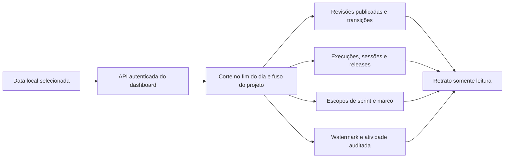

# Dashboard e projeções

## Início e próximas ações

Após autenticar, o dashboard abre na aba **Início**. Ela mostra as próximas ações para o papel de trabalho escolhido entre os papéis que a identidade autenticada possui no projeto. A escolha é apenas uma preferência de navegação e apresentação; todas as operações continuam autorizadas pelo principal e pelos papéis persistidos no servidor. Ela não corresponde ao `SSDD_PROFILE` do transporte MCP, que filtra as ferramentas expostas por conexão.

Para Developer, a home apresenta até oito tarefas atribuídas elegíveis para iniciar sessão (Ready ou Em andamento), até oito tarefas em andamento atribuídas, até três impedimentos e até oito tarefas Ready sem responsável que podem ser assumidas. A lista de claim usa a mesma ordem de prioridade e valor do projeto e só inclui tarefas cujos outros gates de início passaram. **Assumir** grava a atribuição com versão, auditoria e idempotência, mas não inicia sessão; após assumir, abra o detalhe e use o fluxo **Iniciar e abrir sessão**, que repete os gates atomicamente. Uma atualização concorrente ou gate recém-bloqueado é recusado e a fila é recarregada.

Para QA, a home destaca itens em validação e leva à área de cenários/execuções. Para PO, mostra histórias e bugs em Draft que precisam de refinamento. Para Tech Lead, separa itens aguardando revisão de tarefas em Draft. Facilitador vê a sprint do time selecionado e atalhos para Board/retrospectiva. Stakeholder e administração recebem atalhos para roadmap, métricas e histórico. As listas de ação mostram até oito itens e declaram esse limite; a busca global não altera essas listas.

Quando o projeto ainda não tem itens de trabalho, a home exibe um bloco **Primeiro uso** com a ordem recomendada: criar o backlog por `work_item_create`, registrar regras/ADRs com `spec_create` e cenários com `scenario_create`, depois configurar time, capacidade/DoD e sprint. O bloco aponta para Product Backlog e Roadmap, orienta a atualizar após cadastrar pelo MCP e não cria dados nem contorna autorização. As demais abas mantêm mensagens explícitas de estado vazio, em vez de gráficos ou listas sem contexto. Os atalhos das abas usam delegação de evento, então continuam funcionando quando são renderizados dinamicamente nos painéis da home.

## Abas disponíveis hoje

O dashboard atual tem dez abas. A aba Roadmap reúne Features ordenadas por prioridade/valor, progresso em pontos confirmados, bloqueios e timeline de conclusão quando há dados suficientes. A aba Especificações oferece um catálogo somente leitura de regras, glossários, contratos de API, ADRs e requisitos não funcionais.

| Aba | O que permite fazer |
|---|---|
| Início | Abrir na fila do papel selecionado, ver pendências, impedimentos, tarefas que podem ser assumidas e atalhos para as áreas principais. |
| Métricas | Consultar burndown, burnup, previsão, velocidade, WIP, bloqueios e cobertura; filtrar por time, marco, sprint e data de corte; abrir a composição dos indicadores disponíveis e o esforço/calibração por Developer. |
| Roadmap | Ver a ordem de entrega de Features por prioridade e valor de negócio, o progresso de cada Feature e as datas P25/P50/P75 somente quando três sprints comparáveis e escopo estimado permitem uma previsão. |
| Histórico | Selecionar uma data local do projeto e reconstruir itens, revisões publicadas, QA, sessões, releases, sprints, marcos e atividade auditada. |
| Especificações | Consultar o catálogo por tipo e busca, abrir uma especificação, navegar pelas revisões e ler o conteúdo JSON de forma estruturada. Distingue rascunho/em revisão, revisão substituída e revisão retirada. Não cria, edita, publica nem vincula. |
| Product Backlog | Pesquisar histórias e bugs, filtrar por tipo, prioridade, estado e versão, cadastrar um PBI e consultar seus detalhes, tarefas filhas, progresso ponderado e revisões. |
| Board | Consultar o fluxo dos itens, abrir detalhes e propor transições por arrastar/soltar ou controles de teclado; gates e autorização são validados pelo serviço de aplicação. |
| Qualidade | Criar cenários, associá-los a tarefas e critérios, propor/publicar revisões como QA humano, registrar execuções ligadas à revisão publicada, build e tarefas verificadas e consultar resultados recentes. |
| Atividade | Consultar eventos de auditoria do projeto em páginas, com ator, motivo, transição e watermark. |
| Retrospectiva | Consultar retrospectivas de sprints fechadas e revisões históricas. |

### Início seguro de tarefa

Ao mover uma tarefa Ready para Em andamento pelo dashboard, o formulário consulta `GET /api/v1/projects/{projectId}/work-items/{id}/start-readiness` e mostra as condições pendentes. **Iniciar e abrir sessão** envia `POST /api/v1/projects/{projectId}/work-items/{id}/start`; o serviço repete os gates e grava a transição e a sessão atomicamente. Mudança concorrente em estado, versão, responsável, pai/baseline, dependência, ADR ou sessão faz a operação falhar sem deixar uma transição incompleta. A tentativa pelo endpoint genérico retorna `USE_TASK_START`.

`GET /api/v1/projects/{projectId}/quick-access` exige uma sessão autenticada e associação ao projeto. Ele retorna os papéis da sessão, a fila atribuída e as listas curtas de validação/refinamento pertinentes. `POST /api/v1/projects/{projectId}/work-items/{id}/claim` exige CSRF, papel Developer, versão esperada e motivo. A operação revalida Ready, ausência de responsável e todos os gates, exceto a própria atribuição; atualiza responsável, versão e auditoria em uma transação idempotente. Uma tarefa com outros impedimentos não aparece como disponível e não pode ser assumida pela API. `TASK_NOT_STARTABLE`, `TASK_ALREADY_ASSIGNED` e `VERSION_CONFLICT` retornam HTTP 409 com o envelope padrão; a interface mostra o motivo e atualiza a home. O conflito de versão não é retryable: recarregue a tarefa e confirme os gates antes de emitir nova tentativa.

O gate exige dependências diretas concluídas, baseline herdada do PBI pai e revisões publicadas para ADRs ligados como `implements`; `relates_to` é apenas informativo. Uma sessão pausada de outro Developer deve ser concluída/cancelada pelo dono antes do handoff. A tela lista impedimentos calculados, mas não existe hoje um estado de bloqueio manual nem duração genérica de bloqueio. Criação, pesquisa e vínculo de ADR estão disponíveis no MCP; catálogo e edição no dashboard continuam planejados em SSDD-98.

### Workflow ponderado da tarefa

No detalhe da tarefa, a seção **Workflow de execução** apresenta a revisão publicada, a soma do esforço das etapas concluídas, esforço restante, barra com rótulo acessível, etapas ordenadas e histórico de status com autoria, data e motivo. A lista de tarefas filhas no detalhe do PBI apresenta resumo de revisão, percentual e contagem concluída/total. Quando não existe revisão publicada, a interface diz **Sem workflow publicado** e não converte ausência em 0%; um Draft inicial aparece no detalhe e continua sujeito à aprovação.

Developer e Tech Lead podem criar uma proposta com 1–50 etapas, reordená-las por botões acessíveis, definir título/instruções e ajustar os pesos até a soma exata de 100,00%. Salvar cria Draft imutável; um Draft anterior passa a withdrawn e segue no histórico. Somente Tech Lead humano pode publicar. A interface pede motivo e confirmação; o servidor exige tarefa em estado elegível e nenhuma sessão ativa/pausada. Revisões publicadas antigas podem ser selecionadas no histórico para leitura; não podem ser alteradas. A publicação informa etapas preservadas e reiniciadas quando a definição/ordem mudou.

Durante a execução, controles para iniciar, concluir ou retornar uma etapa a Pendente respeitam o papel e o estado retornado pelo MCP. A sessão do Developer deve estar ativa, ser do responsável e ter pinado aquela revisão. Passos só avançam em ordem; a etapa Concluída soma seu peso, enquanto Pendente/Em andamento não somam. Reabrir uma etapa concluída requer Tech Lead humano, todas as sessões fechadas e etapas posteriores reabertas antes, em ordem inversa. Erros de versão recarregam o detalhe; ordem inválida, sessão ausente e Draft inicial exibem o motivo do gate. O percentual é esforço relativo concluído, nunca evidência ou certificação QA.

## Especificações técnicas na interface

A aba **Especificações** é um catálogo somente leitura. Ela consulta `GET /api/v1/projects/{projectId}/specifications` com filtros opcionais `kind`, `search`, `limit` e `cursor`, e `GET /api/v1/projects/{projectId}/specifications/{specIdOrKey}` para o detalhe. A lista mostra chave, título, tipo, última revisão, status dessa revisão (rascunho pendente, em revisão, substituída ou retirada) e publicação vigente; o detalhe permite alternar entre revisões e renderiza o conteúdo JSON arbitrário com rótulos em português para as chaves mais comuns.

O aviso do detalhe depende do status da revisão selecionada. Draft e em revisão exibem **Revisão não publicada** e deixam claro que aquele conteúdo não substitui a publicação vigente — ou que a especificação ainda não tem revisão publicada, quando for o caso. Uma revisão **substituída** exibe **Revisão histórica (substituída)** e informa a publicação vigente, sem tratá-la como conteúdo nunca publicado. Uma revisão **retirada** exibe **Revisão retirada** e informa se existe publicação vigente. Revisões publicadas não mostram aviso. O catálogo não cria, edita, publica, retira nem vincula especificações; essas operações continuam nas tools MCP `spec_list`, `spec_get`, `spec_create`, `spec_revision_propose`, `spec_revision_publish`, `spec_revision_withdraw` e `trace_*`.

No detalhe de uma tarefa, o dashboard reutiliza `task_context_get`: especificações publicadas ligadas à hierarquia ou à tarefa aparecem na seção **Especificações e decisões técnicas**, com revisão e proveniência. Uma especificação Draft sem pin de baseline/sessão não aparece como decisão; o contexto exibe `SPEC_WITHOUT_PUBLICATION`. A revisão cruzada de `SSDD-ARCH-2026-01` confirmou a mesma resposta no MCP, na API HTTP e na tela de detalhe.

O catálogo de leitura reduz a lacuna de visibilidade, mas CRUD completo de especificações/ADRs no dashboard continua planejado em `SSDD-98`; `SSDD-100` exige a matriz de paridade MCP/dashboard. Ambos permanecem Draft e não indicam que a implementação esteja concluída.

A interface atualiza os dados automaticamente a cada 30 segundos enquanto a aba está visível e também oferece atualização manual. Ao voltar para a aba, a interface atualiza imediatamente e retoma o ciclo; o polling fica pausado enquanto o documento está oculto. Os filtros, a data observada e o watermark aparecem nas consultas de métricas. Cada gráfico tem informação equivalente em texto ou tabela onde aplicável. O detalhe de PBI lista tarefas filhas navegáveis. O detalhe de tarefa mostra hierarquia, critérios, regras, decisões técnicas, cenários, runs/builds, alertas de drift, datas derivadas de sessões e eventos de release e o histórico de Developers, falhas e rollbacks. Contexto extenso tem paginação explícita.

O dashboard é uma aplicação local de loopback. Para vários usuários no mesmo host, cada pessoa entra com a `authKey` já administrada pelo MCP; o servidor resolve o principal e os projetos dessa identidade. Papéis por projeto continuam sendo verificados pelos serviços de aplicação compartilhados com o MCP. O dashboard não implementa o fluxo de login interativo OIDC; essa autenticação permanece disponível aos clientes do servidor MCP.

## Retrato histórico por data

Na aba **Histórico**, selecione a data no fuso configurado do projeto e escolha **Ver retrato**. O limite é o fim daquele dia local; o controle começa na criação do projeto e não permite datas futuras. **Hoje** consulta a data atual do projeto. A resposta mostra o corte UTC, o fuso, o horário da consulta e os watermarks de auditoria no corte e na fonte atual.

O retrato reconstitui dados a partir dos registros históricos próprios do SSDD: estado e conteúdo publicado de PBI, revisões publicadas de especificações e cenários, execuções QA e seus vínculos existentes naquela data, eventos de sessão (incluindo início, pausa, retomada e encerramento), eventos de homologação/produção, transições de sprint, mudanças de escopo de sprint/marco e atividade auditada. Sessões ainda abertas acumulam tempo somente até o instante da consulta; o sistema não soma o restante do dia no futuro. Os totais cobrem todo o projeto. Listas mostram até 200 registros por seção; a lista de itens tem **Carregar mais itens**, as demais indicam quando a amostra visível foi truncada e a atividade mostra os 30 eventos mais recentes. O cursor é opaco e vinculado ao projeto, data, watermark e horário da captura: se o workspace mudar entre páginas, o dashboard refaz a primeira página para manter o retrato consistente.

Este retrato é somente leitura e não substitui as abas operacionais. O histórico disponível não é temporal para todos os campos: responsável e ordenação de PBI, bem como estimativas neste painel, não são reconstituídos nem apresentados como valores históricos. Na aba Métricas, WIP e cobertura continuam representando a situação atual conforme definido pela projeção, enquanto as séries de sprint/marco respeitam o corte. Essa distinção evita misturar valores correntes com snapshots passados.



## Abrir o dashboard

No checkout do projeto, compile o pacote e inicialize o workspace uma vez antes do primeiro uso. Os comandos de preparação estão no [início rápido do README](../README.md#preparar-um-workspace). Em seguida, inicie o servidor:

```sh
node dist/src/cli.js dashboard --workspace . --port 4318
```

Abra no mesmo computador a URL com token de uso único impressa no terminal. O primeiro acesso troca o token por um cookie de sessão local e remove o token da barra de endereço. Mantenha o processo ativo durante o uso; `Ctrl+C` encerra o dashboard. Para outro workspace, informe seu caminho em `--workspace`; use outra porta se 4318 já estiver ocupada. Se a porta não puder ser aberta, o comando informa o erro e termina com código diferente de zero, para que scripts e supervisores detectem a falha.

## Autenticação e sessão web

Também é possível abrir a origem local sem o token de bootstrap e entrar com a mesma `authKey` emitida por `user_create` ou pelo bootstrap de administrador do MCP. O formulário envia a chave por `POST /api/v1/session/login` no corpo JSON; a aplicação não a grava em SQLite, cookie, URL, `localStorage` ou `sessionStorage`, e não a devolve na resposta. O host compara o hash persistido, retorna nome/principal e somente os projetos autorizados.

`GET /api/v1/session` devolve a identidade e os projetos da sessão. O login cria uma sessão web aleatória de 12 horas mantida em memória pelo processo; o navegador recebe apenas um cookie `HttpOnly`, `SameSite=Strict`, além do token CSRF da sessão. Todas as mutações exigem `Origin` igual à origem local e `X-SSDD-CSRF`. `POST /api/v1/session/logout` revoga a sessão atual e expira o cookie. Chave rotacionada/revogada deixa de autorizar sessões existentes na próxima chamada protegida.

O login é limitado ao dashboard em `127.0.0.1`: valide host e origem, não exponha essa porta diretamente à rede. Um proxy remoto, fluxo de login OIDC no browser, persistência de sessão após reinício e sessões distribuídas não fazem parte desta interface. O token de bootstrap de uso único impresso pelo processo continua sendo um caminho de entrada para a identidade local do host; proteja o terminal e abra a URL somente em uma sessão local confiável. Para cadastrar pessoas, associar papéis ou rotacionar/revogar chaves, use as ferramentas administrativas `user_create`, `user_list`, `user_auth_key_rotate` e `user_auth_key_revoke` no MCP.

## Como as telas se conectam

```mermaid
flowchart LR
  PBI[PO cadastra PBI] --> REV[Propõe revisão imutável]
  REV --> PUB[PO publica revisão]
  PUB --> SC[QA cadastra cenário e propõe revisão]
  SC -->|associa tarefa(s)| TASK[Tarefa de desenvolvimento]
  SC --> SPUB[QA publica revisão do cenário]
  SPUB --> RUN[Developer ou QA registra execução]
  TASK -->|inclui UUID/chave| RUN
  RUN --> LINK[Execução fica ligada à tarefa, cenário, revisão publicada e build]
  LINK --> CERT[QA certifica pelo MCP]
  CERT --> DONE[Gate Done valida baseline, build, evidências e certificação]
```

O dashboard cobre cadastro/revisão/publicação de PBI, cadastro/revisão/publicação de cenário e registro de execuções. Os formulários de cenário e execução aceitam uma chave ou UUID de tarefa por linha; a edição de cenário pré-carrega os vínculos da revisão publicada para preservar a associação ao propor nova revisão. No detalhe da tarefa, o dashboard mostra os dados versionados consultados por `task_context_get`. Certificar execução é uma operação MCP; os detalhes do PBI exibem certificações já registradas. Essa separação mantém explícitos o papel humano e o gate aplicado ao concluir um item.

## Conteúdo da aba Métricas

A aba **Métricas** reúne burndown da sprint, burnup do marco, cenários de previsão P25/P50/P75, velocidade recente, WIP, bloqueios, cobertura e esforço por desenvolvedor. O seletor global de time filtra sprints, velocidade e previsão; os filtros da aba selecionam marco, sprint e data local de corte. Em projetos com vários times, o usuário escolhe explicitamente um time; uma única equipe é selecionada automaticamente. A janela de velocidade pode usar as últimas 4, 8 ou 12 sprints fechadas da geração comparável; média e mediana são recalculadas para essa janela. As datas de fechamento na tabela de velocidade usam o fuso do projeto, não UTC. A sprint escolhida também é comparada, em pontos aceitos, com a mediana das sprints anteriores da mesma equipe e geração. O resumo do burndown distingue compromisso inicial, escopo no corte, conclusão e alterações acumuladas.

O corte histórico é aplicado às séries de marco/sprint, velocidade e previsão. **WIP e cobertura representam o estado observado agora**, mesmo quando o usuário consulta uma data passada; a interface identifica essa diferença acima dos indicadores para não sugerir reconstrução histórica que esses dois relatórios não fazem. A tela informa a data observada e o watermark; séries usam pontos como unidade explícita e a previsão mostra geração, tamanho de amostra, capacidade e riscos.

Os gráficos exibem até 90 pontos recentes e cada ponto pode ser selecionado pelo mouse ou teclado. A seleção recalcula a leitura no corte daquele dia e lista os PBIs ativos com estado e estimativa usados no total. O detalhamento do marco valida que escopo, restante, concluído e cancelado reconciliam com a série. O detalhamento da sprint usa o último dia efetivo da janela, respeitando seu fechamento. A tabela de WIP lista idade e impactos, a tabela de cobertura abre cada PBI e a tabela de velocidade mostra pontos entregues e horas registradas sem transformar uma unidade na outra.

Os filtros avançados de esforço aceitam data inicial/final e desenvolvedor. As datas usam o fuso do projeto, e a data final é limitada ao corte selecionado; “Usar mês do corte” restaura o intervalo padrão do primeiro dia daquele mês até o corte. Horas ativas incluem sessões concluídas nesse período. A coorte de tarefas usa a última transição para Done no período e considera sessões encerradas até aquela conclusão. Variação e fator comparam horas reais e estimadas apenas nas mesmas tarefas com estimativa de horas confirmada; a amostra mínima de cinco é contada sobre essas tarefas estimadas. Amostras menores continuam visíveis, mas não produzem fator de calibração. A métrica é consultiva, não um ranking, e não altera estimativas automaticamente.

Quando não há time, marco, sprint, amostras ou itens, a aba explica qual dado está ausente. `GET /api/v1/projects/{projectId}/teams` lista os IDs, nomes, configuração e composição disponíveis. `GET /api/v1/projects/{projectId}/dashboard-metrics` e o tool MCP `metrics_get` chamam a mesma projeção de aplicação, dentro de uma transação SQLite comum. Ambos aceitam `teamId`, `milestoneId`, `sprintId` e `asOfDate`; projeto com vários times exige seleção explícita e time inválido retorna opções disponíveis. `none` desativa a seleção de marco ou sprint. A seleção é incluída na chave do cache e na consulta de forecast, velocidade e opções de sprint; previsões persistem snapshots separados por time. A primeira consulta pode gravar um snapshot após a migração v23 sem alterar o escopo nem adicionar evento de domínio. O cache em memória dura até 1 s, após nova checagem de autorização e watermark.

## Capacidade

O resumo da sprint ativa mostra a capacidade calculada e congelada na abertura, junto do objetivo, intervalo e itens. A configuração de calendários, membros, dedicação, feriados ou ausências é feita pelo MCP usando `team_create` e `team_capacity_set`; `team_capacity_get` consulta o resultado. Consulte a seção [Time, calendário e capacidade](mcp.md#time-calend%C3%A1rio-e-capacidade) no contrato MCP.

Por pessoa e dia útil, capacidade = máximo entre 0 e horas padrão menos ausência, multiplicado pela dedicação. A capacidade da sprint é a soma. Dedicação fica entre 0 e 100%. Exemplo: com dois membros, dez dias e seis horas úteis, A com um dia de ausência e dedicação integral contribui 54 h; B a 50% contribui 30 h; total 84 h. A capacidade planejada fica registrada na abertura e correções são auditadas. Horas restantes de tarefas são comparáveis à capacidade; story points representam estimativa relativa do PBI e não são convertidos diretamente para horas.

O MCP calcula capacidade a partir de configurações imutáveis, calendário, dedicação e ausências. `sprint_draft` fixa a versão da configuração e `sprint_start` guarda o cálculo detalhado por dia e pessoa. Planejamento e capacidade também são consultáveis pela API local. O backlog `SSDD-97–100` planeja completar operações de planejamento e paridade no dashboard.

## Backlog e board local

O Product Backlog lista histórias e bugs do projeto com busca por chave/título, filtro por tipo, prioridade, estado e versão. O seletor de time escolhe a sprint ativa e as retrospectivas disponíveis para o planejamento; com vários times, nenhuma sprint é inferida até uma seleção. Quando há sprint ativa no time escolhido, o board limita-se ao escopo comprometido e o Product Backlog reúne o restante; sem sprint ativa, o board mostra os itens que já entraram no fluxo. O resumo da sprint expõe objetivo, datas, quantidade de PBIs, pontos e horas de capacidade da abertura.

Cards de PBI abrem detalhe com descrição, critérios, estimativas, pai, responsável, versões e lista de tarefas filhas navegável. No detalhe da tarefa, a interface consulta o contexto autorizado pelo serviço MCP, junto da timeline, sessões de desenvolvimento, deploys e revisões. Exibe regra de negócio e especificação com revisão, origem (baseline, herança ou vínculo direto) e tipo de link. `implements` sinaliza implementação declarada; `relates_to` fornece contexto relacionado. Cenários e execuções identificam relação por cobertura ou vínculo direto e preservam revisão/build. Drag and drop e o botão “Mover item” por teclado abrem o mesmo formulário de transição. A pessoa informa o motivo e, para Done, a build candidata. A interface chama o endpoint HTTP compartilhado com `expectedVersion`, `requestId` e CSRF; as regras de autorização, workflow, baseline e gates continuam no serviço de aplicação. Um gate recusado mantém o card no estado atual e mostra o diagnóstico. Conflito de versão mantém o estado atual, informa `VERSION_CONFLICT` e recarrega a lista para apresentar a versão mais recente. A tela atualiza a cada 30 segundos enquanto a aba está visível, ao voltar para a aba e também por ação manual.

O botão **Novo PBI** cadastra histórias e bugs com Feature pai, descrição, prioridade e critérios. Em detalhes, **Editar conteúdo** propõe uma revisão imutável; um PO humano publica o rascunho pelo próprio detalhe. Revisões publicadas e rascunhos permanecem visíveis. As operações de atribuição, estimativa, comentários, ranking e vínculos ainda estão planejadas no backlog `SSDD-89`.

Os formulários de épico, Feature e tarefa também aceitam valor de negócio de 0 a 100 e uma justificativa PO obrigatória. O MCP mantém score direto em quatro épicos e 14 Features, com decomposição pelas cinco dimensões da rubrica; tarefas herdam o score da Feature ou épico e podem ter uma avaliação direta quando houver motivo específico. Novos itens sem avaliação mostram **Não avaliado**; a interface nunca interpreta ausência como zero. A prioridade e o score são dimensões distintas. Consulte [ADR 0024](adr/0024-prioridade-valor-e-roadmap-por-feature.md) para regras de herança, rubrica e limites da simulação.

### Visão geral e ordem de entrega

A aba **Roadmap** lê `GET /api/v1/projects/{projectId}/feature-roadmap`, que chama a mesma projeção MCP `project_feature_roadmap_get`. Filtros de time e data local alinham a amostra de velocity à equipe e ao corte; a ordem usa prioridade efetiva ascendente (P1 primeiro), score herdado/definido descendente, rank e chave. Cada Feature mostra valor, pontos concluídos/restantes, percentual quando os pontos confirmados permitem cálculo, itens ativos sem estimativa e dependências externas. Com dados suficientes, a linha do tempo mostra uma faixa P25–P75 e marcador P50 por Feature, sequenciados por sprint na ordem aprovada; datas P25/P50/P75 só são desenhadas quando há pelo menos três sprints fechadas comparáveis da mesma geração e o escopo permite alocação. Sprints planejadas usam as datas reais; quando não há plano, as janelas sintéticas começam depois do corte e da sprint ativa, nunca em datas passadas. Sem esses dados, a interface mantém a ordem e o progresso visíveis, mostra o motivo e omite faixas/datas; isso evita apresentar um cronograma sem base. No workspace atual existe uma sprint fechada comparável de cinco pontos, menos que o mínimo de três, e diversas Features sem estimativa confirmada; a interface mostra `insufficient_velocity_samples` sem datas. A fila de tarefas é um tool de agente separado: `task_execution_queue_get` verifica os gates reais e mostra primeiro o trabalho que pode começar. Hoje não há tarefas em estado Ready atribuídas e startable; isso aparece como fila vazia, sem promover o backlog Draft automaticamente.

Para executar o fluxo de QA, crie um cenário na aba Qualidade, associe-o ao PBI/critério pela cobertura e às tarefas verificadas pelo campo **Tarefas associadas**, proponha sua revisão e publique-a como QA humano. Registre uma execução escolhendo essa revisão publicada e informando build, resultado, notas, URI de evidência e tarefas verificadas. Uma revisão em rascunho não aceita execução. A execução é imutável e conserva as tarefas exatas que validou, a revisão e a build. Para certificar um resultado compatível com a baseline, use `test_run_certify` pelo MCP; certificação não é feita pela interface nesta versão.

## Qualidade e atividade

A tabela de cobertura da aba Métricas mostra até 20 histórias e bugs, com percentual de critérios obrigatórios cobertos, estado da baseline e versão do item. Sem baseline, a linha é identificada como preview; a cobertura não é apresentada como aprovação. A resposta também informa `itemsTotal` e `itemsTruncated`; contagens e percentuais consideram todos os PBIs do projeto, mesmo quando os detalhes são limitados. A cobertura certificada é conservadora: só conta quando a execução certificada por QA ainda é a observação mais recente da revisão do cenário entre os builds; uma execução posterior em outro build remove a certificação anterior da contagem agregada. Abra o detalhe do PBI para consultar seu snapshot completo. No detalhe, o relatório reconstrói os critérios fixados e lista as revisões de cenário incluídas na baseline, última execução por build, certificação compatível e evidências anexadas, com paginação das evidências.

A aba **Qualidade** mostra um gráfico agregado dos 100 runs mais recentes por `passed`, `failed`, `blocked` e `skipped`, com legenda textual equivalente. O histórico mostra cenário, revisão exata, build e link seguro para evidência HTTP(S). O gráfico ainda não tem filtros de build/período nem drill-down; gráfico de cobertura com drill-down e certificação pela UI continuam planejados em `SSDD-93`, `SSDD-95` e `SSDD-96`.

A atividade do projeto e a timeline do PBI usam `audit_events`; cada transição inclui `transitionId` e aponta para o registro original com ator, motivo, versão e estado anterior/posterior. A atividade tem páginas de até 100 eventos, ordenação mais recente primeiro e cursor vinculado ao watermark do projeto. Uma alteração concorrente invalida o cursor e pede uma leitura nova. A API resolve chave e título para PBI, especificações, cenários, sprints, marcos e execuções de teste. Vínculos de rastreabilidade exibem os dois alvos e o tipo de relação, como “PAY-3 · Confirmar pedido implementa SSDD-API-MCP-01 · Contrato MCP”. Eventos de outras entidades mantêm o tipo e a identidade original como fallback. Filtros, paginação e watermark continuam usando os identificadores estáveis.

A aba Retrospectiva lista sprints fechadas e mostra resumo, práticas para continuar/interromper/experimentar e ações com responsável humano e PBI opcional. O seletor permite ler uma revisão histórica. A gravação usa `sprint_retrospective_set` pelo MCP; cada atualização preserva uma nova revisão append-only.

### Smoke visual atual (2026-11-11)

A navegação local conferiu Métricas, Histórico, Product Backlog, Board, Qualidade, Atividade e Retrospectiva, sem enviar formulários ou mover cards. A aba Histórico mostrou o corte de 2026-11-11 no fuso `America/Sao_Paulo`, watermarks `659/659`, 128 itens, 7/7 especificações publicadas, 1/2 cenários publicados e um run QA histórico. Métricas mostrou uma sprint na amostra, 5 pontos e 60 h; o forecast exibe 1/3 sprints comparáveis e cobertura certificada de 3/34 critérios (9%). A aba Qualidade diferencia o cenário publicado do cenário de velocity ainda Draft e exige revisão publicada para registrar execução. A Retrospectiva abriu a revisão histórica da sprint piloto.

O smoke confirma renderização e navegação, não homologação de release. O único run certificado continua ligado à build histórica `local-d89b251`. A legibilidade das relações foi corrigida e tem testes de serviço para PBI, especificação, cenário e execução de teste; falta repetir a inspeção visual depois desta correção. O item MCP `SSDD-126` permanece Draft: seu pai `SSDD-97` ainda não está Ready, não há baseline publicada nem responsável atribuído, então a sessão formal de desenvolvimento não pode ser iniciada. O dashboard oferece catálogo somente leitura de especificações/ADRs; autoria, revisão, publicação e vínculo de specs continuam no MCP, conforme [catálogo de especificações](specification-catalog.md).

Após a correção, o teste integrado da API autenticada confirma que a aba recebe a chave e o título dos dois endpoints de um vínculo PBI→especificação. O smoke visual pós-correção segue pendente porque a sessão de automação não conseguiu validar com segurança a URL da janela Chrome; nenhuma mutação foi enviada pela interface.

## API local e sessão

O comando inicia uma API HTTP somente em `127.0.0.1`. Abrir a URL de bootstrap troca o token de uso único por uma sessão da identidade local. Também é possível entrar no formulário com uma authKey MCP: `POST /api/v1/session/login` valida o hash da chave e associa a sessão ao respectivo principal. `GET /api/v1/session` devolve principal, projetos autorizados e token CSRF; nenhum endpoint aceita `principalId` definido pelo navegador.

Rotas disponíveis:

- `GET /api/v1/health`, `GET /api/v1/projects` e `GET /api/v1/projects/{projectId}`.
- `POST /api/v1/session/login` recebe `{ "authKey": "..." }` no corpo JSON e cria cookie de sessão; `GET /api/v1/session` consulta a identidade e projetos; `POST /api/v1/session/logout` encerra a sessão. O login exige `Origin` local; logout e outras mutações exigem também `X-SSDD-CSRF`.
- `GET /api/v1/projects/{projectId}/history?asOfDate=YYYY-MM-DD&cursor={cursor}` reconstrói um corte autorizado do projeto; `asOfDate` opcional usa hoje no fuso do projeto e o cursor opaco retornado pagina itens no mesmo watermark/captura. Uma alteração auditada invalida o cursor com `STALE_CURSOR` (HTTP 409).
- `GET /`, `/dashboard.js` e `/dashboard.css` servem a interface local com políticas de segurança de conteúdo.
- `GET /api/v1/projects/{projectId}/quality?limit=25&cursor=...` pagina resumos de cobertura obrigatória por PBI (limite máximo 100); `GET /api/v1/projects/{projectId}/audit` lista eventos auditados, com filtros `entityType`/`entityId`, `limit` e `cursor`. Cada evento inclui `entityReference` resolvida para rótulo legível quando o tipo é suportado e `relatedEntities` para os alvos de um vínculo de rastreabilidade; `entityId` permanece disponível para filtros e ações.
- `GET /api/v1/projects/{projectId}/specifications?kind=...&search=...&limit=25&cursor=...` pagina o catálogo de especificações (limite máximo 100); `search` exige 2–160 caracteres e cobre chave, título e conteúdo da última revisão. `GET /api/v1/projects/{projectId}/specifications/{specIdOrKey}` retorna todas as revisões imutáveis e o conteúdo JSON. As duas rotas são somente leitura e aplicam a mesma autorização do MCP.
- `GET /api/v1/projects/{projectId}/dashboard-metrics` agrega burnup, burndown, previsão, velocidade, WIP e cobertura com opções de marco/sprint e watermark comum; filtros opcionais: `milestoneId`, `sprintId` e `asOfDate`.
- `GET /api/v1/projects/{projectId}/developer-execution-metrics` retorna esforço individual agregado por período e filtro opcional `developerPrincipalId`; `from`/`to` são dias locais do fuso do projeto e são inclusivos. A consulta usa as mesmas regras de autorização do MCP.
- `GET /api/v1/projects/{projectId}/development-sessions?itemIdOrKey=...&limit=...` lista sessões da tarefa, com nome do Developer, horários UTC, status e duração ativa.
- `GET /api/v1/projects/{projectId}/deployment-events?itemIdOrKey=...&environment=homologation|production&limit=...` consulta eventos observados, incluindo falha e rollback. O dashboard mostra o último evento aprovado por ambiente como data resumida.
- `GET /api/v1/projects/{projectId}/work-items`, com filtros repetidos `type` e `state`, além de `parentId`, `search`, `limit` e `cursor`.
- `POST /api/v1/projects/{projectId}/work-items` cria PBI; `GET /api/v1/projects/{projectId}/work-items/{itemIdOrKey}/revisions` consulta revisões.
- `POST /api/v1/projects/{projectId}/work-items/{itemIdOrKey}/revisions` propõe conteúdo imutável e `POST .../revisions/{revisionNumber}/publish` publica conforme o papel PO.
- `GET /api/v1/projects/{projectId}/work-items/{itemIdOrKey}`.
- `GET /api/v1/projects/{projectId}/work-items/{taskIdOrKey}/start-readiness` calcula impedimentos atuais; não reserva nem inicia a tarefa.
- `POST /api/v1/projects/{projectId}/work-items/{taskIdOrKey}/start` aceita `expectedVersion`, motivo e `requestId`; muda uma tarefa Ready para `in_progress` e abre a sessão na mesma transação.
- `GET /api/v1/projects/{projectId}/work-items/{taskIdOrKey}/task-workflow?revisionNumber=...` consulta a revisão atual, Draft, histórico e uma revisão histórica opcional.
- `POST /api/v1/projects/{projectId}/work-items/{taskIdOrKey}/task-workflow/revisions` propõe Draft com `expectedTaskVersion`, `expectedWorkflowVersion`, passos e motivo.
- `POST /api/v1/projects/{projectId}/work-items/{taskIdOrKey}/task-workflow/revisions/{revisionNumber}/publish` publica o Draft como Tech Lead humano; o serviço exige ausência de sessões abertas.
- `POST /api/v1/projects/{projectId}/work-items/{taskIdOrKey}/task-workflow/steps/{stepId}/status` transiciona uma etapa publicada com `revisionNumber`, `expectedTaskVersion`, status, motivo e `requestId`.
- `GET /api/v1/projects/{projectId}/work-items/{taskIdOrKey}/context`, com `profile`, parâmetros repetidos `include`, `maxChars` e `cursor`, retorna a mesma projeção autorizada de `task_context_get` e pode ser paginada.
- `GET /api/v1/projects/{projectId}/work-items/{itemIdOrKey}/quality`, com cursor opcional para continuar as evidências; `GET /api/v1/projects/{projectId}/work-items/{itemIdOrKey}/timeline` mostra eventos do PBI.
- `GET /api/v1/projects/{projectId}/sprints?status=active` e `GET /api/v1/projects/{projectId}/sprints/{sprintIdOrKey}`.
- `GET /api/v1/projects/{projectId}/scenarios?limit=25&cursor=...` pagina cenários (limite máximo 100); `POST /api/v1/projects/{projectId}/scenarios` cria cenário; `GET /api/v1/projects/{projectId}/scenarios/{scenarioIdOrKey}` consulta revisões e snapshots.
- `GET /api/v1/projects/{projectId}/scenarios/{scenarioIdOrKey}/revisions/{revisionNumber}/work-items` lista as tarefas vinculadas à revisão, para que a UI preserve as relações ao propor nova revisão.
- `POST /api/v1/projects/{projectId}/scenarios/{scenarioIdOrKey}/revisions` propõe revisão; `POST .../revisions/{revisionNumber}/publish` publica revisão humana QA.
- `GET /api/v1/projects/{projectId}/test-runs?scenario={key}&build={id}&result={passed|failed|blocked|skipped}&limit={1..100}&cursor={opaco}` consulta execuções recentes e devolve `runs`, `nextCursor` e `watermark` (cursor estável como nas demais listas; resultado inválido retorna 400); `POST /api/v1/projects/{projectId}/scenarios/{scenarioIdOrKey}/test-runs` registra execução da revisão publicada, build, resultado e `workItemIdOrKeys` opcional com as tarefas verificadas.
- `GET /api/v1/projects/{projectId}/sprints/{sprintIdOrKey}/retrospective`, com `revisionNumber` opcional para leitura histórica.
- `POST /api/v1/projects/{projectId}/work-items/{itemIdOrKey}/transition`, usando o mesmo comando do MCP; Ready→`in_progress` para tarefa retorna `USE_TASK_START` e exige a rota atômica acima.
- `POST /api/v1/projects/{projectId}/sprints/{sprintIdOrKey}/retrospective`, usando o mesmo comando do MCP e proteção CSRF; a autorização de facilitador humano é aplicada no serviço.

O servidor valida `Host` e `Origin` de loopback, não habilita CORS e define políticas de cache, CSP, enquadramento e referrer. Toda escrita exige `Origin` exata e `X-SSDD-CSRF` obtido na sessão. O token de bootstrap é consumido uma vez por processo; sessões autenticadas expiram em 12 horas, vivem em memória e desaparecem ao encerrar o servidor. A validade da authKey é conferida nas chamadas protegidas para aplicar rotação/revogação imediatamente. Erros mantêm `code`, `message`, `details`, `retryable` e `correlationId`; conflitos de estado/versão retornam 409, validação 400 e falha interna 500. Uma falta de associação ao projeto produz `FORBIDDEN`, igual ao MCP. Todas as rotas de mutação chamam os serviços de aplicação compartilhados e não escrevem diretamente no SQLite. A interface continua local e não carrega scripts ou fontes externos. As demais operações MCP seguem o roadmap `SSDD-85–100`.

Iniciar/pausar/concluir sessões e gravar homologação/produção são mutações disponíveis pelo MCP nesta versão; o dashboard consome as consultas e apresenta as datas/histórico. Use `ssdd_start_task` ou `development_session_*` para registrar desenvolvimento e `deployment_event_record` para registrar um resultado efetivamente observado no ambiente.

## Séries e unidades

| Métrica | Definição |
|---|---|
| Burndown de pontos | Para cada fechamento de dia no fuso do projeto, somar pontos confirmados dos PBIs integrantes e ainda abertos. Inicia pelos compromissos congelados no início da sprint. Deltas separam inclusão, saída, reestimativa, conclusão e reabertura. Um item removido reduz escopo, sem gerar entrega |
| Linha ideal | Pontos fixados no snapshot de início reduzidos linearmente pelos dias úteis do calendário da sprint. Mudanças aparecem apenas na série real e no histórico de escopo |
| Burnup do marco | Séries diárias de escopo ativo, pontos concluídos e remanescentes reconstruídas a partir dos snapshots de aprovação, mudanças de escopo, estimativas e transições |
| Burndown de horas | Somar horas restantes informadas para tarefas abertas do escopo corrente. Exibir cobertura da informação. Faltantes aparecem separadamente |
| Velocidade | Pontos de PBIs entregues com DoD, presentes no conjunto final de uma sprint fechada e atribuídos a ela. Peso confirmado no instante da conclusão final. Reabertura durante a sprint remove o crédito até nova conclusão. Incompletos e removidos ficam sem crédito. Uma sprint fechada com zero entregas conta como zero |
| Cobertura | Critérios obrigatórios com cenário publicado / critérios obrigatórios. Exibir em separado validação certificada por build e baseline |
| WIP e impedimentos de especificação | WIP por estado e tempo desde a entrada no estado; `blockedByOpenImpactCount` conta itens com impacto de revisão publicado ainda aberto. Não há idade geral de bloqueio porque o modelo não registra bloqueio/desbloqueio manual. SSDD-930 planeja eventos temporais de bloqueio |

No dashboard e em `metrics_get`, `asOfDate` é o fim daquele dia no fuso do projeto. A série de velocidade só inclui sprints fechadas até esse corte e usa a geração de composição do time vigente na data. A média e a mediana são calculadas sobre as sprints comparáveis retornadas, inclusive sprints com zero pontos; uma geração sem sprint encerrada aparece sem amostra. O corte e a geração são devolvidos no resultado para tornar a série auditável. Assim, uma alteração de composição não mistura equipes incomparáveis e uma consulta histórica não enxerga entregas futuras.

Velocidade oficial é medida em pontos por sprint. `pointsPerHour` divide os pontos aceitos pelas horas congeladas de capacidade da sprint e é apenas referência descritiva; não converte pontos em esforço e não entra no forecast v2. O forecast v2 exige três e usa até seis sprints comparáveis, com reamostragem de entregas e ajuste explícito pela capacidade futura. Snapshots v1 preservam o cálculo legado em pontos/hora para reprodução. A tela também oferece esforço e calibração individual em horas: a contagem de tarefas concluídas é descritiva, não calcula pontos por desenvolvedor e não deve ser usada como ranking.

Pontos são somados somente em PBIs. A tabela do board pode exibir horas de subtarefas, mas os totais mostram unidade explicitamente. As consultas `application/metrics-queries` já reconstroem burndown, burnup, velocidade, WIP e cobertura em um snapshot de leitura consistente. Cada resposta informa o watermark de auditoria e a data de corte; reabertura remove o crédito dos pontos concluídos, reestimativa não conta como entrega, remoção não conta como entrega e sprint fechada sem aceitos conta como velocidade zero. Datas futuras têm série real vazia. Encerramento antecipado termina a série real na data de fechamento.

## Projeção de entrega

O marco tem escopo aprovado no projeto; os PBIs não pertencem permanentemente a um time. A previsão usa o time selecionado e até seis sprints fechadas dessa mesma geração até o corte local. Exige três amostras válidas e mantém sprints sem entrega como observações de zero pontos. Cada uma das 10.000 simulações sorteia resultados de sprint com reposição. O resultado em pontos é ajustado pela razão entre a capacidade disponível no período futuro e a capacidade da sprint histórica sorteada; a previsão não calcula horas necessárias. Sprints ativa e planejadas conservam as próprias janelas de capacidade; períodos sem plano usam a duração mediana das amostras e a configuração vigente como hipótese identificada. O horizonte cobre 365 dias civis. Dependência incompleta fora do marco e impacto de especificação aberto suprimem as datas; dependências internas são listadas como riscos.

Cada snapshot registra algoritmo v2, seed determinística, quantidade de simulações, amostras, capacidade diária, watermark e data de corte. Repetir a consulta sem mudança de fonte reutiliza o mesmo snapshot; a mesma seed e as mesmas entradas reproduzem exatamente percentis e probabilidade. A probabilidade é a fração de tentativas que termina até a data alvo; se o alvo estiver após o horizonte e o escopo não tiver sido concluído, o campo fica nulo. Os percentis P25/P50/P75 representam datas de conclusão; resultados que não terminam no horizonte são tratados como censurados e podem deixar um percentil sem data. Snapshots v1 permanecem disponíveis e podem ser recalculados pela versão original. Dashboard e `metrics_get` usam o mesmo serviço de aplicação.

Os marcos e snapshots de escopo podem ser criados e consultados pelas ferramentas MCP. A rota local de métricas e previsões e o tool `metrics_get` atendem o dashboard e clientes MCP com filtros e projeção compartilhados; as tabelas de drill-down reconciliam a composição dos totais. O teste de integração compara as duas respostas para os mesmos filtros e watermark; `observedAt` pode ser igual quando ambas reutilizam a mesma projeção em cache.

1. Calcular o restante em pontos dos PBIs abertos no marco. Zero itens abertos resulta em `complete`. Itens sem pontos confirmados resultam em `incomplete_scope` e contagem de lacunas. Exibir cenário provisório apenas com premissa manual explícita, separada do cálculo histórico.
2. Selecionar até seis sprints fechadas comparáveis e do mesmo time/geração, incluindo as que entregaram zero pontos; exigir três amostras com capacidade histórica válida. Sem amostra, responder `insufficient_data`. Geração materialmente diferente nunca entra na amostra.
3. Para cada tentativa, sortear com reposição uma sprint observada para cada janela futura com capacidade. Ajustar os pontos observados pela razão entre a capacidade do período futuro e a capacidade da observação sorteada. O modelo não produz taxa de pontos por hora nem estima horas necessárias.
4. Usar as datas e capacidade congelada da sprint ativa, a configuração fixada em sprints planejadas e a configuração atual como hipótese fora desses planos. Janelas sem sprint usam a duração mediana das amostras. Executar 10.000 tentativas com seed repetível; acumular os pontos simulados até concluir o restante ou alcançar o horizonte de 365 dias. Sem capacidade responde `no_capacity`; amostras de entrega todas zero respondem `zero_velocity`.
5. Retornar datas P25/P50/P75 do tempo de conclusão, mapeadas para Favorável/Base/Cauteloso, e a fração das tentativas que termina até a data alvo. Tentativas sem entrega até o horizonte são censuradas; alvo além do horizonte ou estados que impedem previsão retornam probabilidade nula, exceto quando o escopo já está concluído e a data é conhecida. Persistir seed, entradas, quantidade de tentativas, algoritmo e watermark. Dependência externa bloqueante ou impacto aberto suprime datas; dependências internas permanecem riscos. Snapshots antigos continuam recalculáveis pelo algoritmo gravado.
