# Manual do usuário do dashboard

Este manual explica, tela por tela, o que o dashboard do SSDD MCP mostra e como cada papel o usa no dia a dia. As imagens foram geradas com `scripts/capture-dashboard-screenshots.mjs` sobre os dados reais do próprio projeto SSDD; para refazê-las veja [Como regenerar as imagens](#como-regenerar-as-imagens). Regras de negócio, contratos e rotas estão em [dashboard.md](dashboard.md); instalação e administração de acessos, em [manual-administrador.md](manual-administrador.md).

## 1. Conceitos em um minuto

| Conceito | O que significa |
|---|---|
| **PBI** | Item do Product Backlog: história ou bug. Épicos e Features agrupam; Tarefas executam. |
| **Estados** | Draft → Ready → Em progresso → Em revisão → Em validação → Done (ou Cancelado). Os *gates* do projeto decidem se uma mudança é permitida. |
| **Critério de aceite** | Condição verificável de uma história. Os obrigatórios (`AC-n`) precisam de cenário publicado e execução certificada por QA humano. |
| **Cenário** | Roteiro de teste versionado (revisões). Só revisões **publicadas** recebem execuções. |
| **Execução (run)** | Resultado de um cenário em um *build*: Aprovado, Reprovado, Bloqueado ou Ignorado. A origem (agente, humano ou CI) fica registrada. |
| **Baseline** | Fotografia dos critérios e cenários vigentes de um PBI; mudar a especificação depois gera *impacto* e exige revalidação. |

O dashboard **consulta e propõe**; a autorização é sempre do servidor, pelos papéis que você tem no projeto. Os botões que você não pode usar mostram o motivo da recusa em vez de falhar em silêncio.

## 2. Entrar

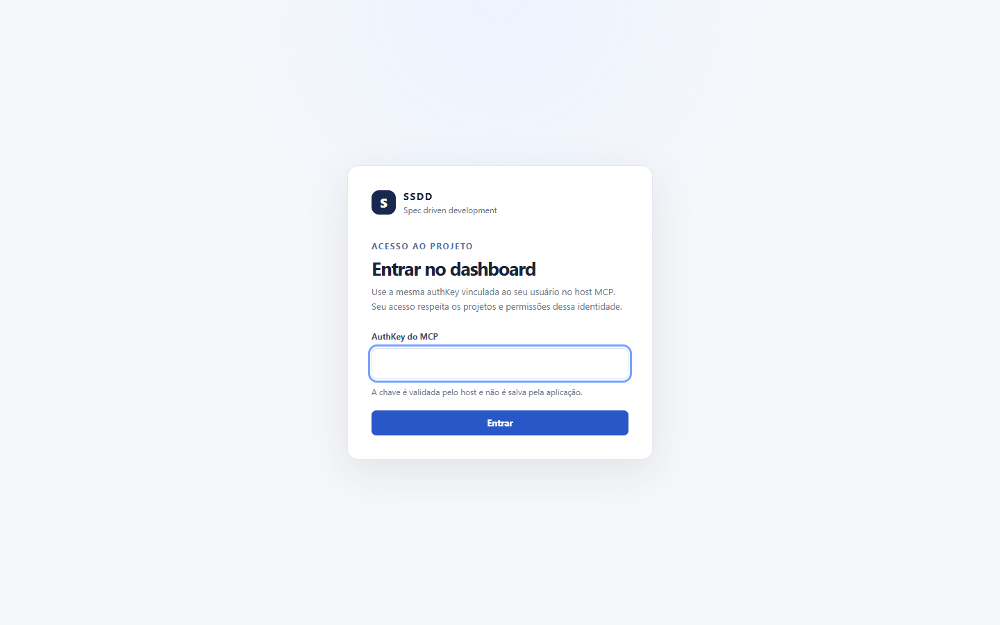

1. Abra a URL de uso único impressa pelo comando `dashboard` (ela traz o token de bootstrap) **ou** abra o endereço sem token e informe a sua **authKey** do MCP.
2. A chave só trafega no envio do formulário; o navegador não a guarda. Ao entrar você recebe uma sessão web efêmera.
3. **Sair** (canto superior direito) encerra a sessão. Se o servidor for reiniciado a sessão expira e o login reaparece.

Se a mensagem de erro indicar falta de projeto, peça associação ao administrador.

## 3. Estrutura da tela

- **Cabeçalho:** seletor de **Projeto** e de **Time**, atualização manual (↻), seu nome e **Sair**. O botão **Planejamento** abre as operações de sprint, capacidade e marcos.
- **Abas:** Início, Métricas, Roadmap, Histórico, Especificações, Product Backlog, Board, Qualidade, Atividade e Retrospectiva. A aba ativa aparece também no título da janela do navegador.
- **Atualização:** os dados recarregam sozinhos a cada 30 segundos enquanto a janela está visível; o horário da última leitura fica no topo.
- **Teclado:** todas as abas, botões, diálogos e o board têm operação por teclado; `Esc` fecha diálogos e o foco visível é destacado em azul.

## 4. Início — sua fila de trabalho

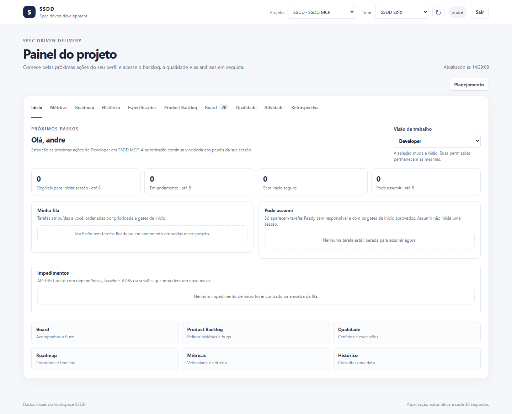

Escolha a **Visão de trabalho** (Developer, QA, PO, Tech Lead, Facilitador, Stakeholder ou Administração, entre os papéis que você possui). Mudar a visão só reorganiza a tela; suas permissões continuam as mesmas.

- **Developer:** tarefas atribuídas prontas para iniciar, em andamento, impedimentos (dependências, baseline, ADR ou sessão) e tarefas que você pode **Assumir**. Assumir apenas atribui; para começar abra o detalhe e use **Iniciar e abrir sessão**.
- **QA:** itens em validação e atalho para Qualidade.
- **PO:** histórias e bugs em Draft que precisam de refinamento.
- **Tech Lead:** itens aguardando revisão e tarefas em Draft.
- Cada lista mostra até oito itens e declara o limite. Em projeto vazio aparece o bloco **Primeiro uso** com a ordem recomendada.

## 5. Product Backlog

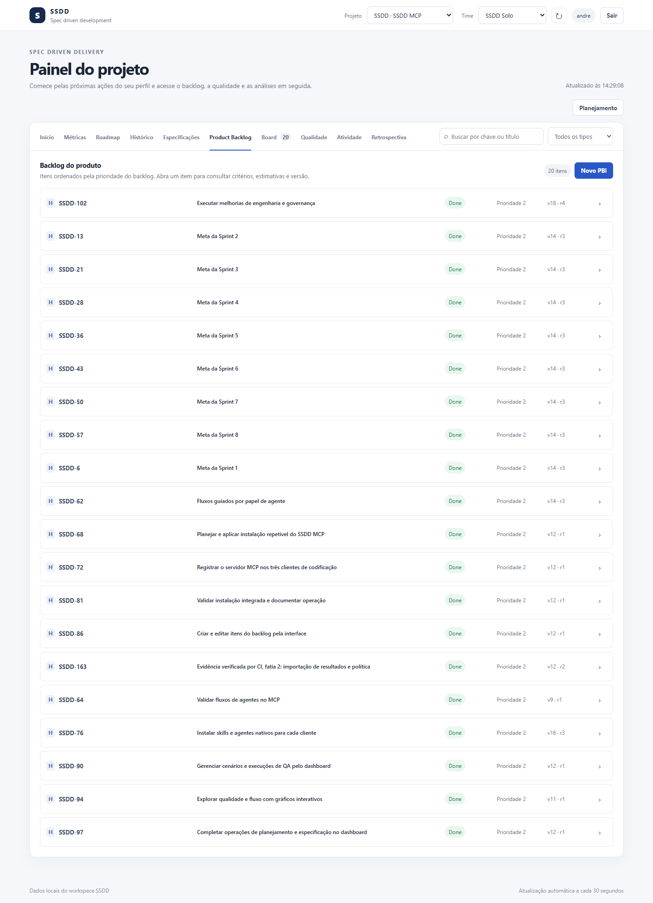

- Pesquise por chave ou título e filtre por tipo, prioridade, estado e versão.
- Cada linha mostra o tipo (passe o mouse sobre a marca **H/B/F/E/T** para ver o nome completo), a chave, o título, o estado, a prioridade e a versão/revisão. Clique na linha para abrir o detalhe.
- **Novo PBI** abre o formulário de cadastro:

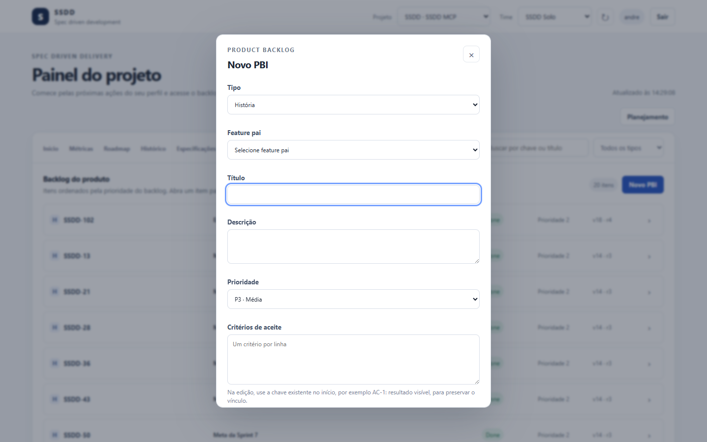

Informe tipo, item pai (Feature para história/bug), título, descrição, prioridade (P1 mais alta … P4 mais baixa) e **um critério de aceite por linha**. Ao editar um critério existente, mantenha a chave (`AC-1: …`) para preservar o vínculo com cenários.

### Detalhe do item

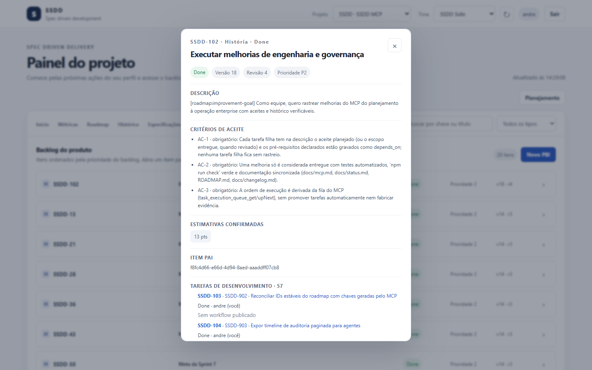

Mostra descrição, critérios, estimativas confirmadas, item pai, tarefas filhas com progresso ponderado, responsável, cenários, execuções, alertas de *drift* e histórico. Em tarefas aparece também o **Workflow de execução** (etapas com peso; soma exata de 100%) e as **Especificações e decisões técnicas** que valem para a tarefa. Revisões de PBI são propostas e publicadas aqui, respeitando o papel de cada pessoa.

## 6. Board

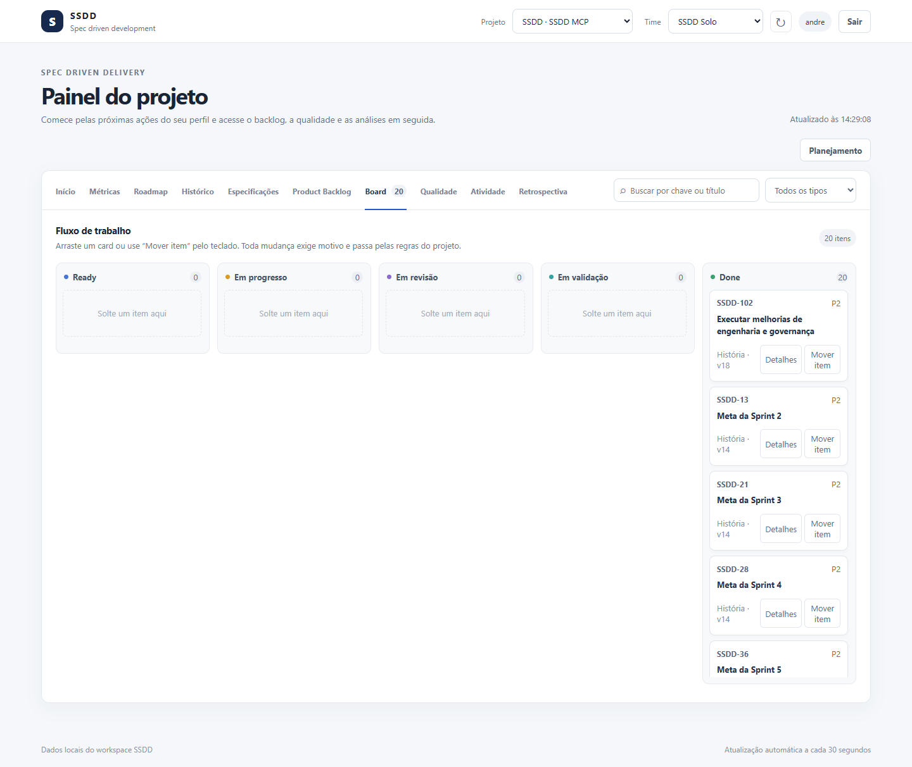

Colunas por estado com contagem. Use a busca e o filtro de tipo no topo.

- **Mudar de estado:** arraste o card para a coluna desejada **ou** use **Mover item** (acessível por teclado). Em ambos os casos o diálogo pede o **motivo** e confirma:

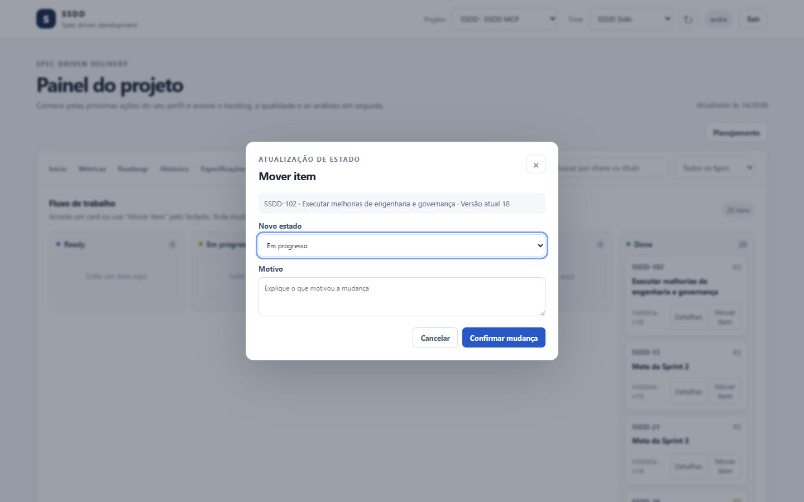

- Se um *gate* recusar (por exemplo, falta de evidência, estimativa ou critério), a mensagem diz exatamente o que falta; nada é movido pela metade.
- Colunas longas rolam internamente; o cabeçalho fica visível.
- Tarefas Ready usam o fluxo atômico **Iniciar e abrir sessão**, que mostra as condições pendentes antes de confirmar.

## 7. Qualidade

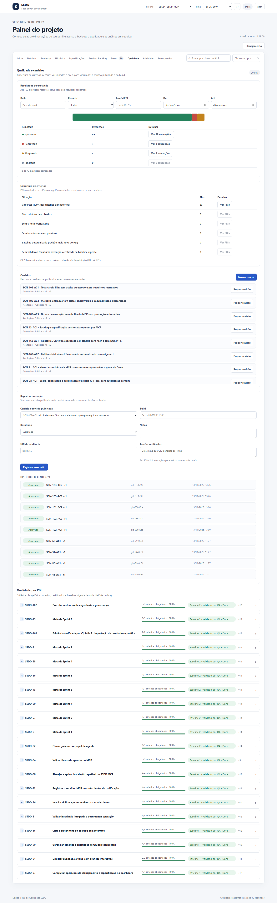

De cima para baixo:

1. **Resultados de execução:** barra e tabela por resultado, com filtros (build, cenário, tarefa/PBI, período) e botão **Ver n execuções**.
2. **Cobertura de critérios:** quantos PBIs têm todos os critérios obrigatórios cobertos, com lacunas, sem baseline, baseline desatualizada ou sem validação.
3. **Cenários:** lista com revisão publicada; **Novo cenário**, **Publicar rN** e **Propor revisão**. A publicação exige papel de QA humano.
4. **Registrar execução:** escolha o cenário e a revisão publicada exata, informe o build, o resultado, notas, URI da evidência e as tarefas verificadas.
5. **Histórico recente:** execuções com resultado, cenário, build e data (a lista rola; as mais recentes ficam no topo).
6. **Qualidade por PBI:** progresso de critérios obrigatórios e baseline de cada história.

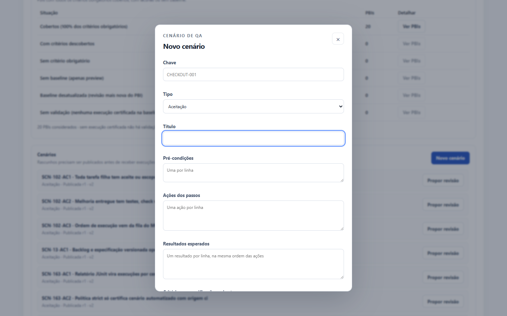

Certificar uma execução (aceite humano de QA) continua sendo uma operação do MCP (`test_run_certify`); o dashboard exibe as certificações existentes. Importar relatórios JUnit de CI também é feito pelo MCP (`test_run_import_junit`).

## 8. Especificações

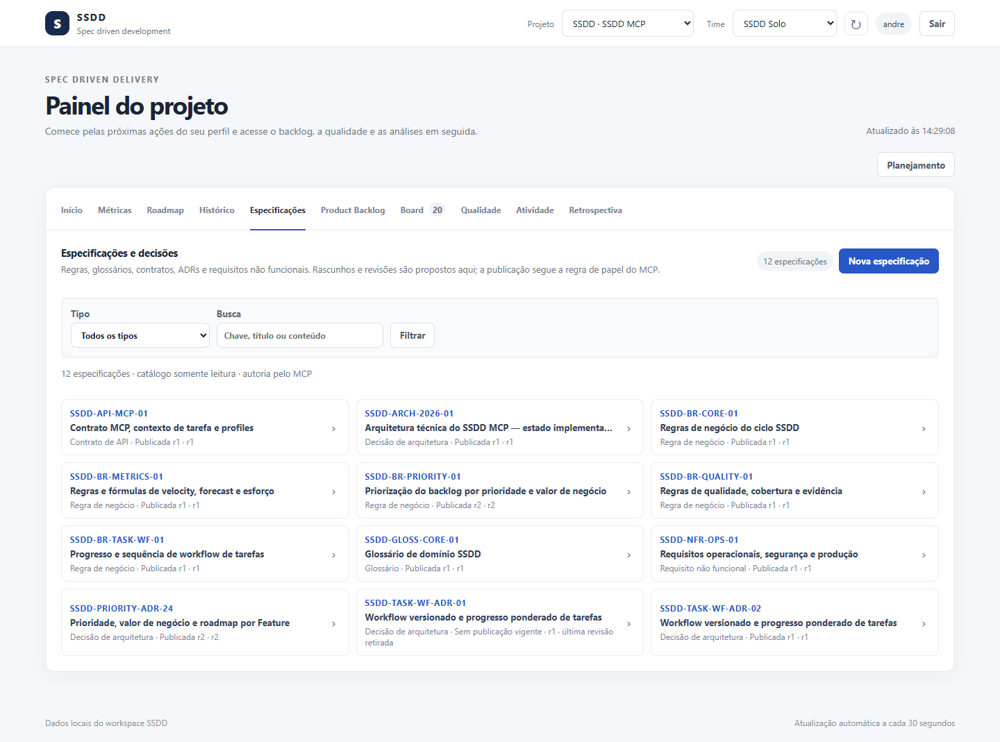

Catálogo de regras, glossários, contratos de API, ADRs e requisitos não funcionais. Filtre por tipo ou busque por chave, título e conteúdo. Ao abrir uma especificação a lista cede espaço ao detalhe, com navegação entre revisões e aviso de **Revisão não publicada**, **histórica** ou **retirada**.

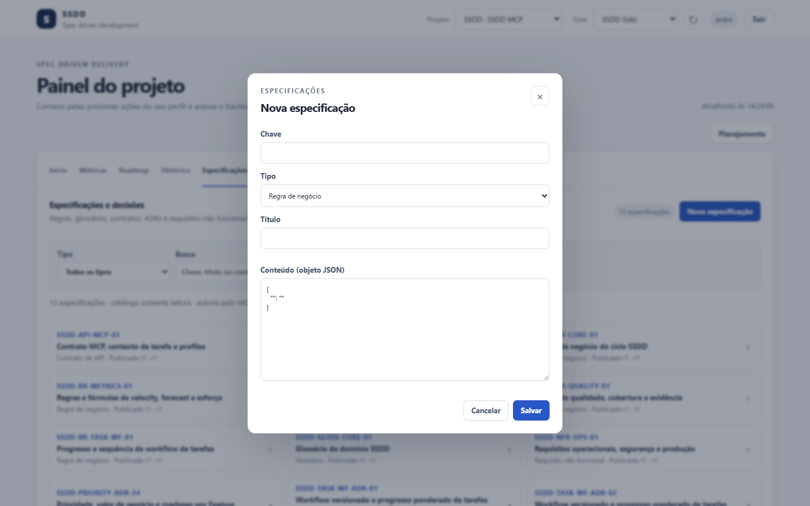

**Nova especificação** cria um rascunho; a publicação segue a regra de papel do MCP.

## 9. Roadmap

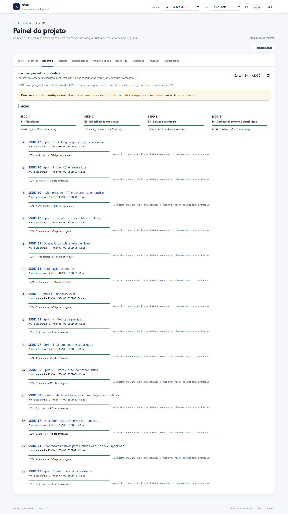

Resumo de progresso por épico e Features em ordem de execução (prioridade efetiva e valor de negócio), com progresso por pontos confirmados. As datas P25/P50/P75 só aparecem com ao menos três sprints fechadas comparáveis e escopo estimado; sem isso o aviso amarelo explica por quê.

## 10. Métricas

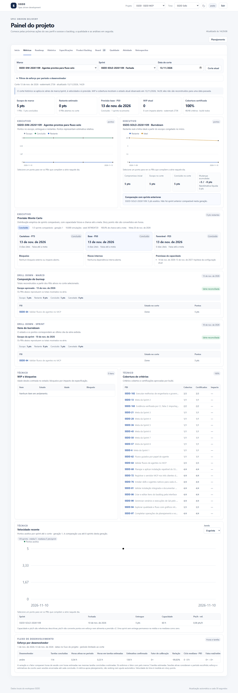

Filtros de **Marco**, **Sprint** e **Data de corte** (séries históricas respeitam o corte; WIP e cobertura mostram o estado atual e dizem isso na nota). Painéis: indicadores-chave, burnup/burndown com drill-down por PBI, previsão Monte Carlo, WIP e bloqueios, cobertura de critérios, velocidade (janelas de 4/8/12 sprints) e esforço por desenvolvedor. Todo gráfico tem tabela ou texto equivalente. Pontos de história **não** são convertidos em horas.

## 11. Histórico


Escolha uma data (no fuso do projeto) para reconstruir itens, revisões publicadas, QA, sessões, releases, sprints, marcos e atividade auditada naquele dia. Tabelas longas rolam dentro do painel e têm cabeçalho fixo; os limites de cada recorte são declarados.

## 12. Atividade e Retrospectiva

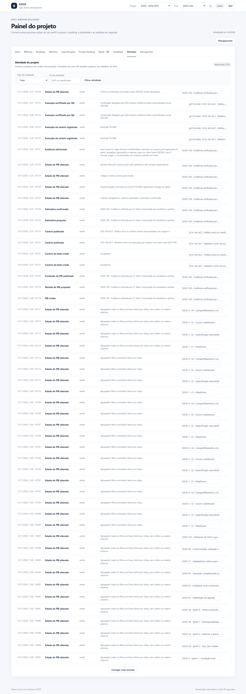

**Atividade:** eventos de auditoria do projeto, do mais recente ao mais antigo, com ator, motivo, transição e *watermark*, em páginas.

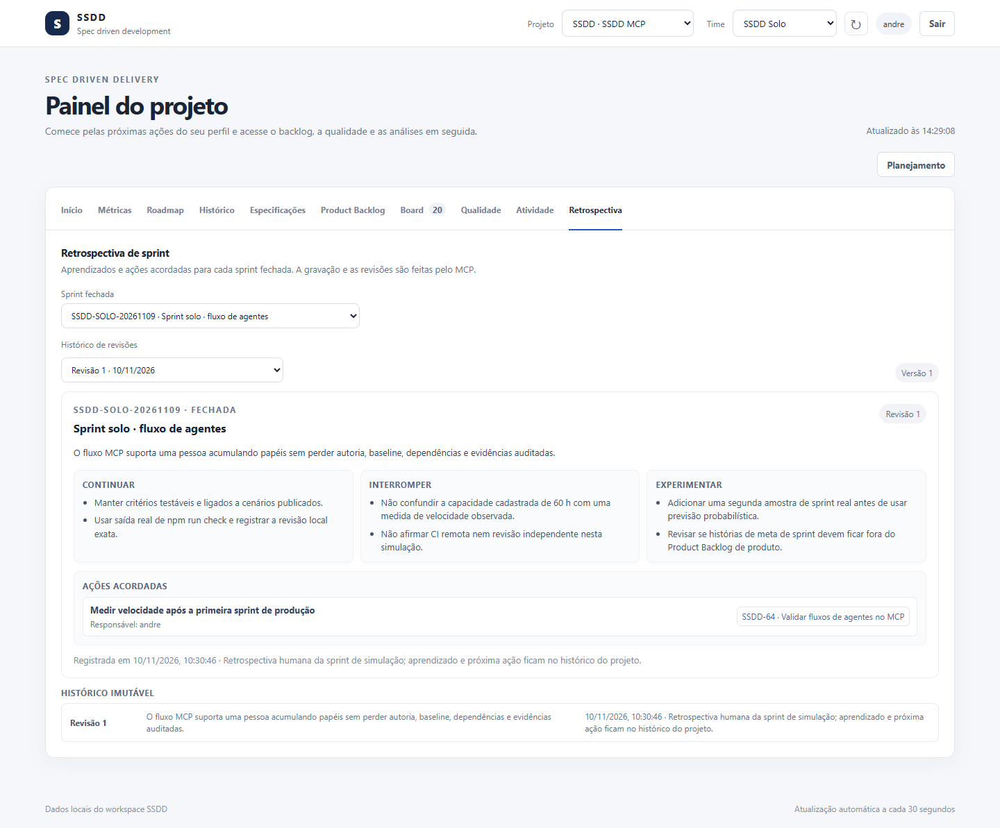

**Retrospectiva:** aprendizados e ações acordadas de cada sprint fechada. A gravação e as revisões são feitas pelo MCP.

## 13. Planejamento

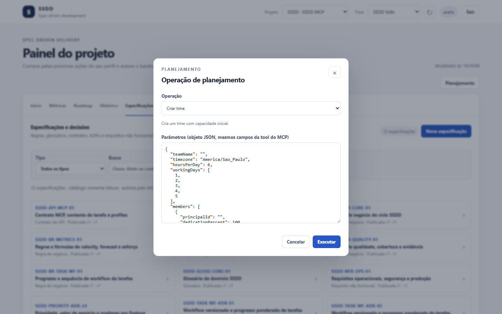

Reúne as operações de sprint, capacidade e marcos disponíveis para o seu papel. Cada operação é idempotente, versionada e auditada. **Atenção:** nesta versão o formulário pede os parâmetros como um objeto JSON com os mesmos campos da tool MCP correspondente (um modelo é preenchido ao escolher a operação); formulários guiados por campo ainda não existem.

## 14. Mensagens e erros comuns

| Mensagem | O que fazer |
|---|---|
| `VERSION_CONFLICT` | Alguém alterou o item. Recarregue o detalhe e confirme antes de tentar de novo; não é retentável automaticamente. |
| `GATE_BLOCKED` / `TASK_NOT_STARTABLE` | Leia os impedimentos listados (dependência, baseline, ADR, estimativa, evidência) e resolva-os. |
| `USE_TASK_START` | Use **Iniciar e abrir sessão**, não a mudança genérica de estado. |
| `FORBIDDEN` | Seu papel não permite a ação. Troque a visão só ajuda a navegar; peça o papel ao administrador. |
| Sessão expirada | Entre novamente com a authKey. |

## Como regenerar as imagens

```sh
npm run build
node dist/src/cli.js dashboard --workspace <pasta> --port 4318     # imprime a URL com token
node scripts/capture-dashboard-screenshots.mjs "<url-com-token>" docs/images
```

O script precisa de Chrome (`SSDD_BROWSER_CHANNEL=msedge` troca o canal), só abre abas e diálogos e não grava dados. Use uma **cópia** do workspace se não quiser expor o banco real.
