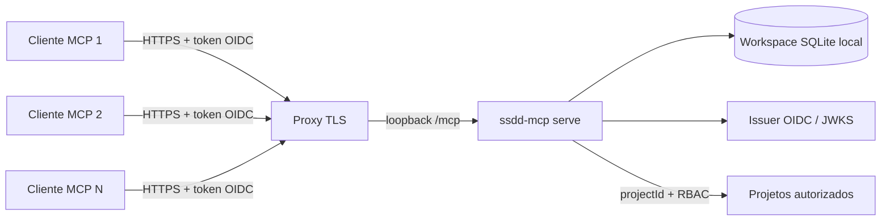

# Servidor MCP para uma equipe

Este runbook descreve como publicar um servidor SSDD por Streamable HTTP para vários clientes e como limitar cada identidade a um ou mais projetos. O modo recomendado hoje é **uma instância SSDD em um host**, acessada por clientes remotos através de um proxy TLS com OAuth/OIDC. O servidor atende vários clientes concorrentes e projetos no mesmo workspace; a persistência SQLite não torna segura uma implantação ativa em múltiplos nós.

## Topologia suportada



- O processo escuta somente em `127.0.0.1`; não há opção para bind em interface pública.
- O proxy publica `POST/GET/DELETE /mcp` e o metadata OAuth `GET /.well-known/oauth-protected-resource/mcp` em HTTPS. Mantenha `Host` público ao encaminhar para o processo.
- `/healthz` e `/readyz` são probes mínimos para a rede local do operador; não os publique externamente.
- O diretório `.ssdd` e seu banco devem estar em armazenamento persistente local do mesmo host do processo. Não use NFS/SMB nem execute dois processos `serve` ativos sobre o mesmo arquivo.
- O protocolo moderno `2026-07-28` é sem sessão de transporte. Clientes que negociam uma versão anterior podem usar sessão legacy mantida em memória; reiniciar o processo desconecta essas sessões, e balancear clientes legacy exigiria afinidade de sessão. Essas propriedades do protocolo não removem o limite de escrita do SQLite desta aplicação. Consulte a [especificação Streamable HTTP](https://github.com/modelcontextprotocol/modelcontextprotocol/blob/main/docs/specification/2026-07-28/basic/transports/streamable-http.mdx) e o [guia de serving do SDK TypeScript](https://github.com/modelcontextprotocol/typescript-sdk/blob/main/docs/serving/http.md).

## Preparar workspace e projetos

Use Node.js 24 ou 26 e npm 10 ou superior. No host de serviço:

```sh
npm ci
npm run build
node dist/src/cli.js init --workspace /srv/ssdd --key PAY --name "Pagamentos" --goal "Pagamentos confiáveis" --timezone America/Sao_Paulo
node dist/src/cli.js init --workspace /srv/ssdd --key CRM --name "Relacionamento" --goal "Relacionamento com clientes" --timezone America/Sao_Paulo
node dist/src/cli.js doctor --workspace /srv/ssdd
```

Cada `init` com uma chave nova registra outro projeto no mesmo `.ssdd/ssdd.sqlite`; repetir a mesma configuração é idempotente. Uma chave já usada com configurações divergentes falha sem substituir dados.

## Configurar identidade e autorização

Crie um resource no provedor OIDC com issuer público estável e tokens de acesso JWT assinados por algoritmo assimétrico. O access token deve conter `iss`, `sub`, `exp`, `aud` compatível com a URL do MCP e o scope `ssdd:mcp`. O servidor valida descoberta/JWKS e não emite tokens nem aceita token opaco.

Depois de iniciar o modo OIDC, provisiona-se cada identidade `iss+sub` no banco e concede-se o menor conjunto de papéis necessário por projeto. Rode o comando administrativo localmente como principal com papel `admin`:

```sh
node dist/src/cli.js access grant --workspace /srv/ssdd --project PAY \
  --issuer https://login.example.com/tenant --subject "subject-from-token" \
  --display-name "Ana Souza" --type human --roles po,developer \
  --reason "Acesso de engenharia ao projeto PAY"
```

Repita o grant para `CRM` somente se a pessoa ou serviço também precisar desse projeto. Use `--type agent` ou `--type service` para automações; esses tipos não passam gates que exigem pessoa humana. Revogue papéis com `access revoke`. Claims de papéis do token não concedem acesso. Mutações feitas por agentes/serviços continuam sujeitas aos mecanismos de aprovação de uso único do SSDD.

Configure issuer, URL canônica e porta. A URL do resource precisa ser HTTPS pública e terminar em `/mcp`:

```sh
node dist/src/cli.js serve --workspace /srv/ssdd --port 4319 \
  --oidc-issuer https://login.example.com/tenant \
  --resource-url https://mcp.example.com/mcp
```

Se um cliente legítimo enviar `Origin`, `--allowed-origin <hostname>` adiciona hostnames à verificação de origem, apenas no modo OIDC. Passe somente hostname, sem esquema, porta ou caminho. Isso não habilita CORS. Não inclua origem de navegador sem necessidade.

## Proxy TLS de referência (Nginx)

Configure certificado e política TLS no bloco `server` público. Encaminhe somente `/mcp`; ajuste o caminho do upstream e preserve o Host canônico usado em `--resource-url`:

```nginx
server {
    listen 443 ssl;
    server_name mcp.example.com;

    # ssl_certificate e ssl_certificate_key são configurados pela operação TLS.

    location = /mcp {
        proxy_pass http://127.0.0.1:4319/mcp;
        proxy_http_version 1.1;
        proxy_set_header Host $host;
        proxy_set_header X-Forwarded-Proto https;
        proxy_set_header X-Forwarded-For $proxy_add_x_forwarded_for;
        proxy_buffering off;
        proxy_read_timeout 3600s;
        proxy_send_timeout 3600s;
    }

    location = /.well-known/oauth-protected-resource/mcp {
        proxy_pass http://127.0.0.1:4319/.well-known/oauth-protected-resource/mcp;
        proxy_http_version 1.1;
        proxy_set_header Host $host;
        proxy_set_header X-Forwarded-Proto https;
        proxy_set_header X-Forwarded-For $proxy_add_x_forwarded_for;
    }

    location / {
        return 404;
    }
}
```

Não exponha `4319` na interface de rede, não encaminhe o dashboard local e não encaminhe `/healthz` ou `/readyz`. O caminho de metadata é necessário para o discovery OAuth do resource server. A configuração acima é um exemplo de roteamento; autenticação de acesso à rede, certificados, rate limits e política de logs pertencem à infraestrutura da organização.

## Executar como serviço no Linux

Instale o pacote/build em `/opt/ssdd-mcp`, crie uma conta de serviço sem shell interativo e deixe `/srv/ssdd/.ssdd` gravável somente por ela. Configure integrações opcionais em `/etc/ssdd-mcp.env` com permissões `root:root 0600`; essa unidade não grava segredo no repositório.

```ini
# /etc/systemd/system/ssdd-mcp.service
[Unit]
Description=SSDD MCP Streamable HTTP server
After=network-online.target
Wants=network-online.target

[Service]
Type=simple
User=ssdd
Group=ssdd
WorkingDirectory=/opt/ssdd-mcp
Environment=NODE_ENV=production
EnvironmentFile=-/etc/ssdd-mcp.env
ExecStart=/usr/bin/node /opt/ssdd-mcp/dist/src/cli.js serve --workspace /srv/ssdd --port 4319 --oidc-issuer https://login.example.com/tenant --resource-url https://mcp.example.com/mcp
Restart=on-failure
RestartSec=5s
KillSignal=SIGTERM
TimeoutStopSec=35s
NoNewPrivileges=true
PrivateTmp=true
ProtectSystem=strict
ProtectHome=true
ReadWritePaths=/srv/ssdd/.ssdd

[Install]
WantedBy=multi-user.target
```

Adapte o caminho do Node, issuer, URL, usuário e workspace. Aplique com `systemctl daemon-reload` e `systemctl enable --now ssdd-mcp`; acompanhe `systemctl status ssdd-mcp` e `journalctl -u ssdd-mcp`. `SIGTERM` fecha o listener, handlers e sessões legacy antes de o processo sair. Reinício encerra qualquer sessão legacy que ainda estivesse conectada.

## Conectar um cliente e escolher o projeto

Configure o cliente MCP como servidor remoto Streamable HTTP usando `https://mcp.example.com/mcp` e o fluxo OAuth compatível do cliente/provedor. O metadata OAuth precisa estar acessível em `https://mcp.example.com/.well-known/oauth-protected-resource/mcp`. A forma do arquivo de configuração varia por cliente; use o campo de URL HTTP remoto, não `command/args` stdio.

O projeto é escolhido no cliente/agente e enviado **em cada chamada**:

1. Ao conectar, chame `project_list`; a resposta já contém somente projetos autorizados para a identidade autenticada e lista os papéis concedidos.
2. Se houver mais de um, peça à pessoa para escolher por chave/nome. Guarde o UUID retornado como contexto do cliente.
3. Use esse UUID no argumento `projectId` de cada ferramenta; valide o projeto com `project_get` antes de iniciar uma operação mutável.
4. Para trocar de projeto, escolha outro UUID de `project_list`. Cada chamada ainda passa autorização no servidor, inclusive para um UUID que o cliente tente enviar diretamente.

Não existe “projeto ativo” global no processo nem estado escondido compartilhado entre conexões. Essa escolha evita que dois clientes concorrentes alterem sem querer o contexto um do outro. O prompt pode receber um `projectId`, mas o valor precisa vir da seleção anterior do cliente.

## Verificar, monitorar e operar

```sh
curl --fail http://127.0.0.1:4319/healthz
curl --fail http://127.0.0.1:4319/readyz
node dist/src/cli.js doctor --workspace /srv/ssdd
node dist/src/cli.js backup --workspace /srv/ssdd --output /srv/backup/ssdd.sqlite
```

- `/healthz` confirma que o processo HTTP responde; `/readyz` confirma uma leitura SQL mínima. Ambos retornam apenas um estado fixo e `GET` é o único método aceito.
- Faça backup e valide restore antes de atualizar o schema. As migrations v25/v26 acrescentam sessões/deployments e o mapeamento estável de IDs do roadmap; o arquivo SQLite continua sendo o registro operacional único.
- Para registrar execução, atribua a tarefa ao Developer, passe-a para `in_progress` e chame `development_session_start`; o mesmo Developer pausa/retoma/conclui a sessão. Horários são UTC do servidor. Sessões ativas não são fechadas automaticamente por encerramento abrupto: revise-as após recuperação e peça ao Developer que pause ou conclua a sessão.
- Homologação e produção são eventos de deployment separados de `Done`. Registre pelo MCP apenas o resultado realmente observado; produção aprovada exige build com homologação aprovada. A UI mostra as datas no detalhe da tarefa e métricas individuais agregam horas/sessões concluídas.
- O MCP ainda não oferece endpoint de métricas de Prometheus, logs estruturados completos ou tracing distribuído. Use o supervisor e os logs do serviço para estado do processo e monitore `/readyz` pela rede interna; essas lacunas estão no roadmap.
- Faça backups regulares para destino protegido, aplique retenção e criptografia definidas pela organização e teste `restore` em workspace separado. Pare o serviço antes de restaurar ou atualizar o banco.
- Armazene variáveis de integração em um secret manager e injete-as ao processo. Não grave tokens nos arquivos do repositório nem nos argumentos de ferramentas.
- Em qualquer restart, clientes modern protocol podem reconectar por requisição. Clientes legacy precisam inicializar a sessão novamente.

## Limites de implantação

| Necessidade | Suporte atual |
|---|---|
| Vários clientes MCP simultâneos | Sim, por uma instância Streamable HTTP e um arquivo SQLite local |
| Vários projetos isolados logicamente | Sim, no mesmo workspace; descoberta via `project_list` e autorização por projeto |
| Identidade remota e papéis | Sim, OAuth/OIDC JWT provisionado como `iss+sub`, RBAC por projeto |
| Instâncias ativas em vários nós usando o mesmo banco | Não; SQLite/WAL requer processos no mesmo host e este runbook suporta uma instância ativa |
| Alta disponibilidade automática/failover sem desconexão | Não; ainda exige desenho e testes de persistência/coordenação |
| Sessões modernas persistentes | Não se aplicam ao protocolo moderno; sessão legacy é volátil e mantida em memória |
| Sessões de desenvolvimento e esforço individual | Sim; sessões explícitas, pausas, duração ativa, atribuição histórica e calibração por horas, com aviso para amostras abaixo de cinco tarefas |
| Data de homologação e produção separadas de Done | Sim; derivadas de eventos imutáveis e vinculados a build/tarefa; a UI lê o histórico e a gravação é feita pelo MCP |
| Recuperação automática de sessão ativa após queda abrupta | Não; sessão precisa de revisão e pausa/conclusão explícita quando o serviço voltar |

As lacunas e critérios de evolução estão em [ROADMAP.md](../ROADMAP.md#auditoria-e-pr%C3%B3ximas-melhorias-do-mcp). A decisão de topologia e seleção explícita de projeto está no [ADR 0016](adr/0016-implantacao-compartilhada-http.md). Para detalhe de protocolo e catálogo, consulte [docs/mcp.md](mcp.md); para banco e segurança, [docs/architecture.md](architecture.md).
